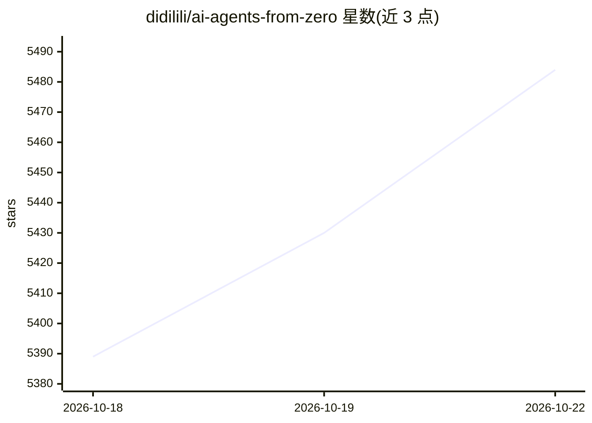

# didilili/ai-agents-from-zero

⭐ 5,517 · Python · MIT · 推送 2026-10-14 · [GitHub](https://github.com/didilili/ai-agents-from-zero) · [官网](https://didilili.github.io/ai-agents-from-zero/) · 个人维护 · 中文 README

**面向转型开发者的 AI Agent 系统教程：讲义+源码+面试题库**

开源的 AI 智能体学习路径仓库，按章节组织：大模型基础、低代码平台（Coze/Dify）、LangChain/LangGraph 框架、企业级 RAG/Agent 实战项目、LoRA 微调与开发规范。提供可运行案例源码与独立面试题库，对标 AI 应用开发工程师岗位与招聘 JD。技术主线为 Python 生态，明确不走 Java 路线（Spring AI/langchain4j）。通过 git clone + venv + requirements.txt 安装，需配置模型 API Key 或使用 Ollama 本地模型。内容长期更新中，两个实战项目已完成。

## 筛选速览

| 维度 | 判定 | 备注 |
|---|---|---|
| AI 角色 | `ai-knowledge` | 知识聚合/清单类 |
| 许可风险 | `permissive` | MIT |
| 部署形态 | `library` | 以包/库形式分发 |
| 模型依赖 | local-ok | 支持本地模型 |
| 硬件要求 | — | 无带数字的原话,不猜 |
| 安装摩擦 | `low` | 无编译、无系统依赖或容器化 |
| 成熟度 | — | 结构信号不足 |

## 能力要点

- 教程+可跑源码+面试题库三位一体，按岗位能力域组织
- 覆盖 LangChain/LangGraph/MCP/RAG/微调全链路，含多个企业级实战项目源码
- Python 技术主线，明确不走 Spring AI/langchain4j Java 路线
- 支持 Ollama 本地模型替代云 API（无需 Key）

## 适用场景

- 系统学习 AI Agent 与大模型应用开发并跑通案例
- 准备 AI 应用开发工程师面试与项目复盘
- 前端/后端/产品背景转型 AI 智能体开发

## 场景标签

`教程课程` · 领域:学习与行业

## 证据(README 行号)

> L38: - **🌱 全网首个系统开源的 AI 智能体教程**：这是一套长期维护的 AI 大模型应用开发路线图。市面上不缺零散帖子，也不缺收费训练营，但真正系统、持续更新，并且覆盖 **教程 + 源码 + 实战项目 + 面试题库** 的 A
> L44: - **📚 教程源码面试，三位一体能跑通**：不止「看完」，还能「跑通」更能「答出来」——**可运行案例与源码**、**提示词模板**与部署思路，拒绝「只讲概念」。面试题库按**培训班与 JD** 常见能力域拆题，其中有相当一部分
> L194: - **内容构成**：**系统章节笔记** + **可运行案例源码** + **面试题库** （对标**同类线上培训**与**社招/校招 JD**）。

## 星数曲线

2026-10-18 5,389 → 2026-10-22 5,484（+95）

---
*卡片 v1 · prompt 1.4 · 生成 2026-10-20 · 置信度 high · 依据 README sha `0ed63371b4a8` · [字段定义](../../DATASET.md)*
