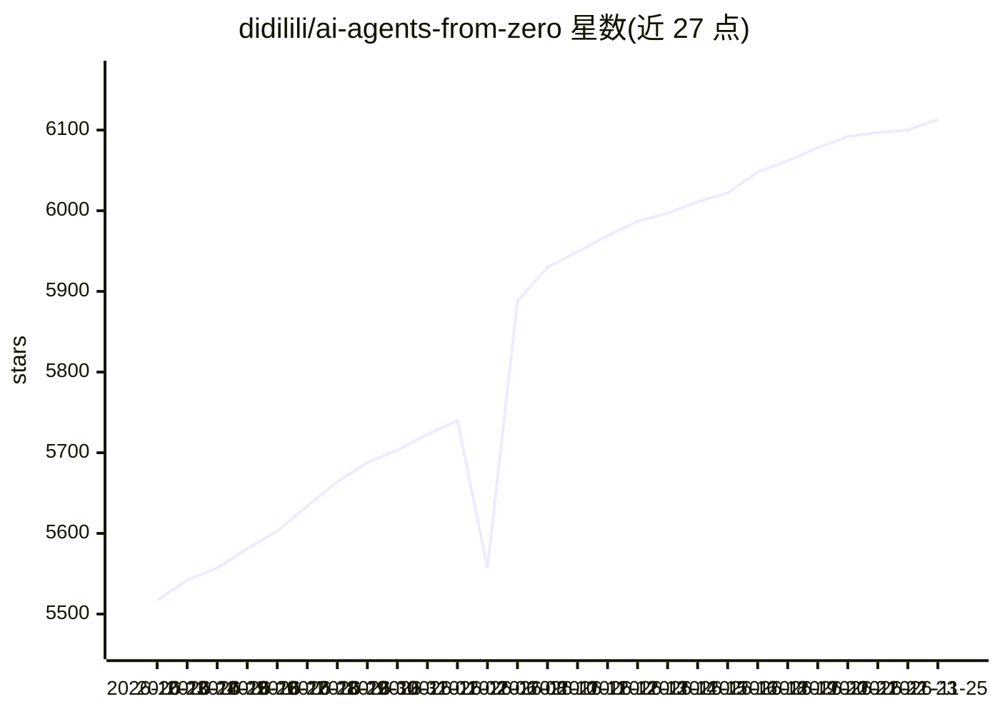

# didilili/ai-agents-from-zero

⭐ 6,113 · Python · MIT · 推送 2026-11-06 · [GitHub](https://github.com/didilili/ai-agents-from-zero) · [官网](https://didilili.github.io/ai-agents-from-zero/) · 个人维护 · 中文 README

**AI Agent 开发的系统化中文教程仓库：从零学到企业级落地**

一套长期更新的中文 AI 智能体实战教程，包含系统章节笔记、可运行案例源码与面试题库三部分。内容按概念篇→低代码平台→开发框架→RAG/Agent 项目实战→微调→大厂规范编排，附两个已完成实战项目（NL2SQL+LangGraph 电商问数、DeepAgents 多智能体深度研搜）。聚焦 Python+LangChain/LangGraph 路线，不走 Java 路线；参考尚硅谷课程资料重构补充。案例以「能跑起来」为标准，提供环境说明与 API Key 配置指引，可用 Ollama 本地模型替代云 API。

## 筛选速览

| 维度 | 判定 | 备注 |
|---|---|---|
| AI 角色 | `ai-knowledge` | 知识聚合/清单类 |
| 许可风险 | `permissive` | MIT |
| 部署形态 | `library` | 以包/库形式分发 |
| 模型依赖 | local-ok | 支持本地模型 |
| 硬件要求 | — | 无带数字的原话,不猜 |
| 安装摩擦 | `low` | 无编译、无系统依赖或容器化 |
| 成熟度 | — | 结构信号不足 |

## 能力要点

- 教程+源码+面试题库+实战项目四合一的学习路线
- 两个已完成的实战项目：电商问数与深度研搜（含源码仓库）
- 技术栈覆盖 LangChain/LangGraph、Coze/Dify、MCP、RAG、微调
- git clone 后配 .env API Key 即可运行第一个案例

## 适用场景

- 系统学习 AI Agent/大模型应用开发全栈知识
- 转岗或备考 AI 应用开发工程师岗位时刷面试题
- 找可运行的 RAG/多智能体项目源码做参考

## 场景标签

`教程课程` · 领域:学习与行业

## 证据(README 行号)

> L4:  2026 持续更新中 · 目标打造 「地表最强」 AI Agent 教程 —— 系统教程 + 可跑源码 + 面试题库 + 企业级实战项目 + 长期技术栈更新 ，全面对齐「AI 智能体 / 大模型应用开发工程师」 培训课表 与 招聘
> L204: - **内容构成**：**系统章节笔记** + **可运行案例源码** + **面试题库** （对标**同类线上培训**与**社招/校招 JD**）。
> L48: - **🌱 全网首个系统开源的 AI 智能体教程**：这是一套长期维护的 AI 大模型应用开发路线图。市面上不缺零散帖子，也不缺收费训练营，但真正系统、持续更新，并且覆盖 **教程 + 源码 + 实战项目 + 面试题库** 的 A

## 星数曲线

2026-10-23 5,517 → 2026-11-25 6,113（+596）

---
*卡片 v1 · prompt 1.4 · 生成 2026-11-22 · 置信度 high · 依据 README sha `e02fc4edb01f` · [字段定义](../../DATASET.md)*
