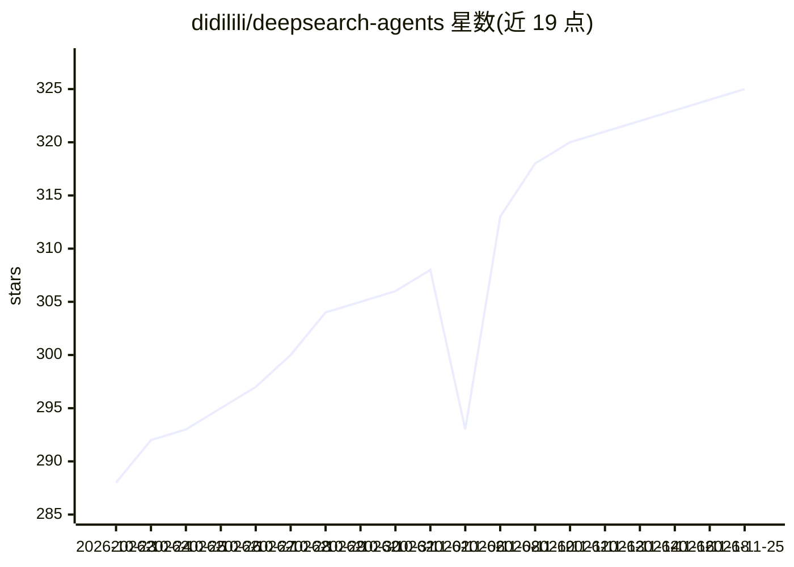

# didilili/deepsearch-agents

⭐ 325 · Python · 推送 2026-11-06 · [GitHub](https://github.com/didilili/deepsearch-agents) · [官网](https://didilili.github.io/ai-agents-from-zero/#/%E5%AE%9E%E6%88%98%E9%A1%B9%E7%9B%AE-%E6%B7%B1%E5%BA%A6%E7%A0%94%E6%90%9C/0-%E5%89%8D%E8%A8%80) · 个人维护 · 中文 README

**配套教程的多智能体深度研究实战项目：学 DeepAgents 工程落地**

基于 DeepAgents + LangGraph 构建的对话式多智能体深度研究系统，采用一主三从架构：主智能体负责任务规划与调度，网络搜索（Tavily）、MySQL 结构化查询、RAGFlow 知识库三个专家子智能体分别检索不同信息来源，最终汇总生成 Markdown/PDF 交付物。后端 FastAPI + WebSocket 提供任务、上传、下载与事件推送接口，前端 React/Vite 展示执行链路。仓库同时是 ai-agents-from-zero 教程体系的配套源码，提供 14 个章节的图文讲义与对应 Git 分支，README 声明不包含权限、任务队列、评测等生产治理能力。

## 筛选速览

| 维度 | 判定 | 备注 |
|---|---|---|
| AI 角色 | `ai-knowledge` | 知识聚合/清单类 |
| 许可风险 | `none` | — |
| 部署形态 | `self-host` | docker 或自建部署 |
| 模型依赖 | — | README 未给出锁定关系 |
| 硬件要求 | — | 无带数字的原话,不猜 |
| 安装摩擦 | `low` | 无编译、无系统依赖或容器化 |
| 成熟度 | — | 结构信号不足 |

## 能力要点

- 一主三从 Orchestrator-Workers 多智能体架构，按来源分工检索
- Tavily/MySQL/RAGFlow/上传附件四类信息来源统一汇总，产出 Markdown/PDF
- FastAPI + WebSocket 全链路事件推送，执行过程可观察
- 14 章节免费教程与 Git 分支逐阶段对照代码演进

## 适用场景

- 系统学习 DeepAgents 多智能体框架与子智能体调度
- 学习 FastAPI + WebSocket 的前后端实时联动工程实现
- 搭建能同时查公开网络、数据库与私有知识库的研究助手
- 准备大模型应用开发的简历项目与面试题

## 场景标签

`多智能体` `RAG` `教程课程` · 领域:Agent 开发

## 证据(README 行号)

> L3:  可能是全网最适合用于系统学习 DeepAgents 的多智能体深度研究实战项目，配套系统性文字教程与对应章节分支，带你打通主智能体调度、专家助手分工、多来源检索、文件交付与前后端实时联动全链路
> L21: > 本套仓库是 ai-agents-from-zero 教程体系中的 实战项目-深度研搜 配套源码仓库，除了可直接运行和二次开发的项目代码之外，也提供了与教程章节对应的 Git 分支演进过程，以及完整的在线图文讲义入口。
> L85:  - 项目配有一套系统化、完全免费的教程讲义，适合按章节从 DeepAgents 基础、子智能体、Backend、中间件一直学到完整项目闭环。

## 星数曲线

2026-10-23 288 → 2026-11-25 325（+37）

---
*卡片 v1 · prompt 1.4 · 生成 2026-11-25 · 置信度 mid · 依据 README sha `7928f91b00e0` · [字段定义](../../DATASET.md)*
