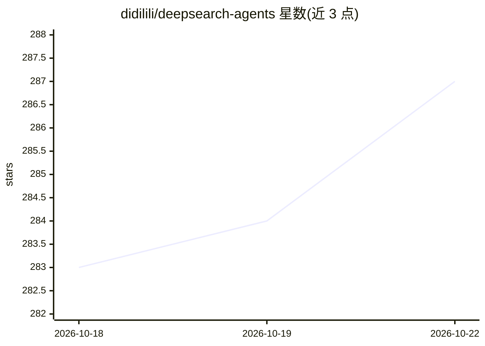

# didilili/deepsearch-agents

⭐ 287 · Python · 推送 2026-10-14 · [GitHub](https://github.com/didilili/deepsearch-agents) · [官网](https://didilili.github.io/ai-agents-from-zero/#/%E5%AE%9E%E6%88%98%E9%A1%B9%E7%9B%AE-%E6%B7%B1%E5%BA%A6%E7%A0%94%E6%90%9C/0-%E5%89%8D%E8%A8%80) · 个人维护 · 中文 README

**对话式多智能体深度研搜系统，面向 DeepAgents 学习与实战**

基于 DeepAgents/LangGraph/LangChain 构建的一主三从多智能体研究助手：主智能体调度网络搜索助手（Tavily）、数据库查询助手（MySQL）、RAGFlow 知识库助手，可读取上传附件，生成 Markdown/PDF 交付物；FastAPI + WebSocket + React 前后端实时联动，Docker Compose 部署 MySQL 教学库。模型经 OpenAI 兼容接口接入（默认示例为 DashScope）。仓库配套 ai-agents-from-zero 免费教程与按章节演进的 Git 分支；README 声明其未覆盖登录权限、任务队列、事件持久化等生产治理能力，定位为学习工程骨架而非企业级生产系统。

## 筛选速览

| 维度 | 判定 | 备注 |
|---|---|---|
| AI 角色 | `ai-native` | 本体是模型或模型工具 |
| 许可风险 | `none` | — |
| 部署形态 | `self-host` | docker 或自建部署 |
| 模型依赖 | — | README 未给出锁定关系 |
| 硬件要求 | — | 无带数字的原话,不猜 |
| 安装摩擦 | `low` | 无编译、无系统依赖或容器化 |
| 成熟度 | `idea` | |

## 能力要点

- 一主三从多智能体架构（主智能体+网络搜索/数据库/RAGFlow 三助手）
- 多来源检索与文件交付：Tavily、MySQL、RAGFlow、上传附件读取，生成 Markdown/PDF
- FastAPI + WebSocket 实时推送工具调用、助手调用与结果事件，React 前端
- 配套免费教程与章节代码分支，可按阶段对照学习

## 适用场景

- 系统学习 DeepAgents 多智能体开发并跑通完整工程链路
- 搭建结合网络搜索、数据库与私有知识库的深度研究助手
- 参考 FastAPI/WebSocket 前后端实时联调的 Agent 项目骨架

## 场景标签

`多智能体` `RAG` `教程课程` `科研工具` · 领域:Agent 开发

## 证据(README 行号)

> L19: 它不是只调用一次大模型接口，也不是套一个搜索 API 做问答演示。这个项目围绕深度研究场景，用 DeepAgents 组织主智能体和专家子智能体，让系统可以根据任务需要查公开网络、查结构化数据库、查 RAGFlow 私有知识库、读
> L47: 所以「深度研搜」更像一个会分工、会查资料、会生成交付物的研究助手。用户只需要提出任务，系统会在后端组织一条可观察的多智能体执行链路。
> L90: 项目采用 DeepAgents 中典型的 Orchestrator-Workers 模式：主智能体作为调度中心，三个专家助手负责信息获取，文件工具由主智能体直接掌握。

## 星数曲线

2026-10-18 283 → 2026-10-22 287（+4）

---
*卡片 v1 · prompt 1.4 · 生成 2026-10-22 · 置信度 high · 依据 README sha `8f355d6d2ad8` · [字段定义](../../DATASET.md)*
