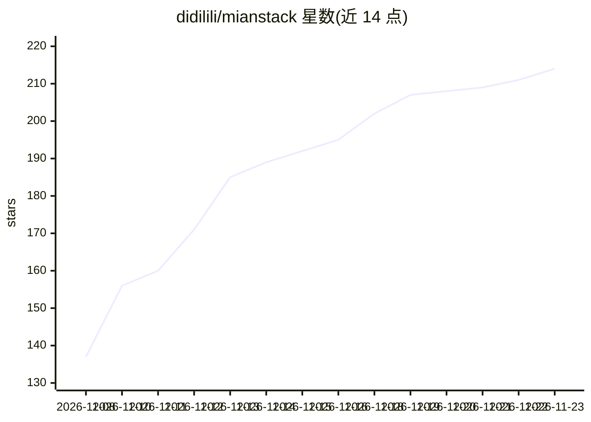

# didilili/mianstack

⭐ 214 · JavaScript · MIT · 推送 2026-11-19 · [GitHub](https://github.com/didilili/mianstack) · [官网](https://MianStack.com) · 个人维护 · 中文 README

**开源程序员面试题库：面经、题解与 AI 方向备考资料**

面向求职程序员的开源面试题库（MIT 许可）：收录 8,300+ 道面试题、600+ 道参考答案与持续更新的真实面经，把面经提问与考点按公司、岗位、轮次关联，支持按知识点、专题、题型和难度筛选，并提供热榜与复习标记（浏览器本地存储、免注册）。内容以 Markdown/JSON 保存在仓库中，可读取制作自己的复习或检索工具；另配套 ai-agents-from-zero 教程与两个实战项目源码（电商问数、深度研搜）。贡献通过 Issue 进行，无需安装项目。

## 筛选速览

| 维度 | 判定 | 备注 |
|---|---|---|
| AI 角色 | `ai-knowledge` | 知识聚合/清单类 |
| 许可风险 | `permissive` | MIT |
| 部署形态 | `None` |  |
| 模型依赖 | — | README 未给出锁定关系 |
| 硬件要求 | — | 无带数字的原话,不猜 |
| 安装摩擦 | `low` | 无编译、无系统依赖或容器化 |
| 成熟度 | — | 结构信号不足 |

## 能力要点

- 8,300+ 道面试题、600+ 参考答案、真实面经与公司/岗位关联
- 八大知识方向覆盖模型、RAG、Agent、工程与算法
- 题目与答案以 Markdown/JSON 开放，可自建检索或阅读工具
- 配套 ai-agents-from-zero 教程与两个完整实战项目源码

## 适用场景

- 按目标公司与岗位定向准备技术面试
- 查找 AI/RAG/Agent 方向高频考点与参考答案
- 用仓库开放数据自建复习或检索工具

## 场景标签

`教程课程` · 领域:学习与行业

## 证据(README 行号)

> L67: 已收录 **8,300+ 道面试题**，另有 **350+ 份公开题集**，保留题集发布者、原题与出处，方便对照不同资料查漏补缺。
> L123: 题目、参考答案与公开面经原文使用 Markdown 保存，公开题集的原题与出处使用 JSON 保存。除了直接阅读，也可以用本仓库的公开内容制作自己的检索、复习工具或阅读网站。读取方式见 **数据使用说明**。

## 星数曲线

2026-11-08 137 → 2026-11-23 214（+77）

---
*卡片 v1 · prompt 1.4 · 生成 2026-11-17 · 置信度 high · 依据 README sha `1507cdabb84e` · [字段定义](../../DATASET.md)*
