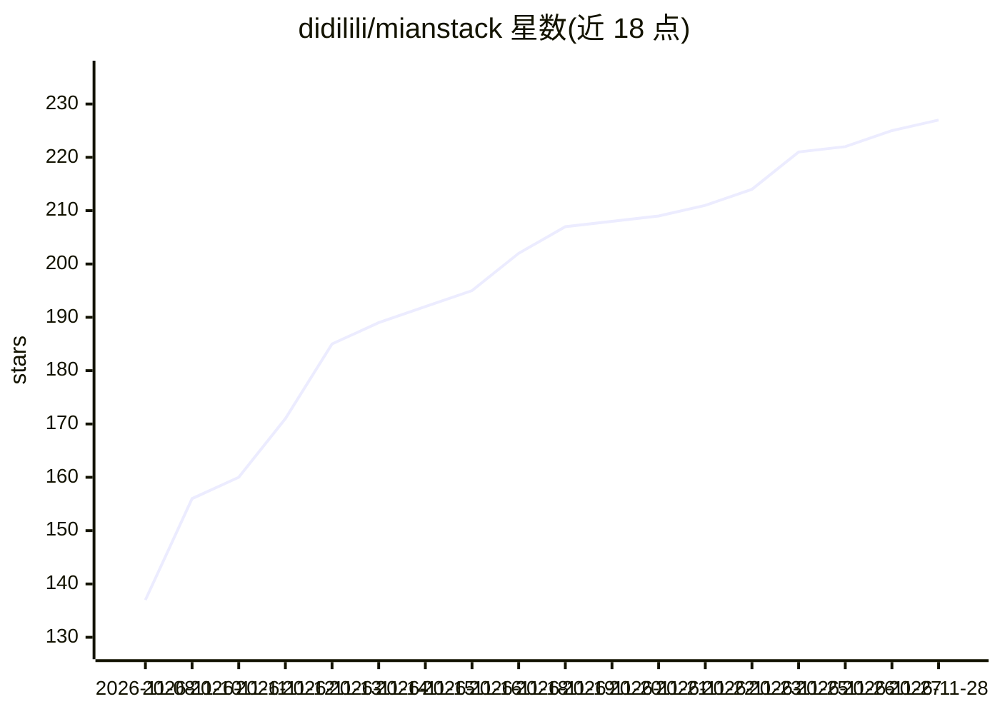

# didilili/mianstack

⭐ 227 · JavaScript · MIT · 推送 2026-11-27 · [GitHub](https://github.com/didilili/mianstack) · [官网](https://MianStack.com) · 个人维护 · 中文 README

**程序员面试题库：AI/Java/算法考题关联真实面经备考**

以 Markdown/JSON 数据形式开放收录的程序员面试题库，包含 8,300+ 道题、600+ 参考答案、真实面经与 350+ 公开题集。核心机制是把真实面经中的提问与考点关联，支持按公司、岗位、难度、专题筛选，并有近 60 天热问榜与 60 道核心题速览。内容覆盖大模型、RAG、Agent、训练对齐及软件工程八大方向；题目与答案在本仓库开放，配套 ai-agents-from-zero 教程源码与两个实战项目；网站侧的关联与专题功能不包含在仓库数据中。

## 筛选速览

| 维度 | 判定 | 备注 |
|---|---|---|
| AI 角色 | `ai-knowledge` | 知识聚合/清单类 |
| 许可风险 | `permissive` | MIT |
| 部署形态 | `None` |  |
| 模型依赖 | — | README 未给出锁定关系 |
| 硬件要求 | — | 无带数字的原话,不猜 |
| 安装摩擦 | `low` | 无编译、无系统依赖或容器化 |
| 成熟度 | — | 结构信号不足 |

## 能力要点

- 8,300+ 道题与 600+ 参考答案，题目与答案以 Markdown/JSON 在仓库开放
- 面经与考点关联，按公司/岗位/轮次/难度筛选
- 20 个真实开源项目的架构、选型、源码拆解
- 配套 ai-agents-from-zero 教程与两个实战项目源码

## 适用场景

- 按目标公司面经定向准备 AI 应用岗位面试
- 考前突击高频考点与 60 道核心题
- 用题库数据制作自己的检索或复习工具
- 跟着配套教程源码补 RAG/Agent 项目经历

## 场景标签

`教程课程` · 领域:学习与行业

## 证据(README 行号)

> L122: 题目、参考答案与公开面经原文使用 Markdown 保存，公开题集的原题与出处使用 JSON 保存。除了直接阅读，也可以用本仓库的公开内容制作自己的检索、复习工具或阅读网站。读取方式见 **数据使用说明**。
> L126: ├── questions/        # 面试题、考点与参考答案

## 星数曲线

2026-11-08 137 → 2026-11-28 227（+90）

---
*卡片 v1 · prompt 1.4 · 生成 2026-11-25 · 置信度 high · 依据 README sha `e3917ea72a97` · [字段定义](../../DATASET.md)*
