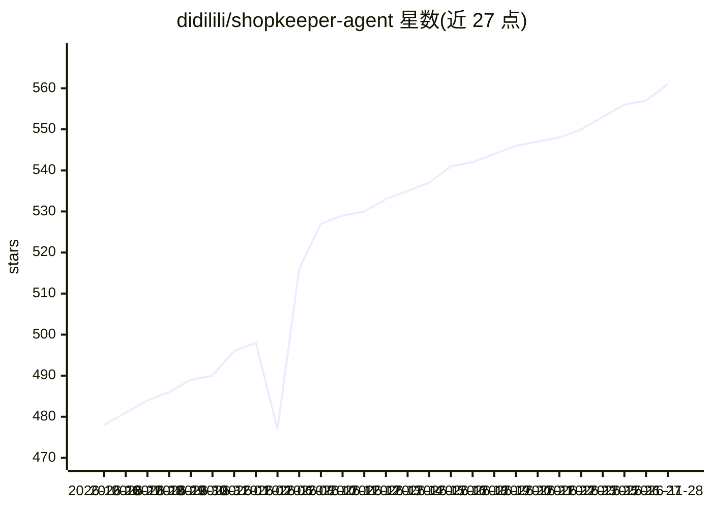

# didilili/shopkeeper-agent

⭐ 561 · Python · MIT · 推送 2026-11-06 · [GitHub](https://github.com/didilili/shopkeeper-agent) · [官网](https://didilili.github.io/ai-agents-from-zero/#/%E5%AE%9E%E6%88%98%E9%A1%B9%E7%9B%AE-%E7%94%B5%E5%95%86%E9%97%AE%E6%95%B0/0-%E5%89%8D%E8%A8%80) · 个人维护 · 中文 README

**电商数仓自然语言问数 AI Agent 实战项目与配套教程**

基于 LangGraph 编排的电商数据仓库问数系统：先从教学数仓抽取表、字段、指标与取值构建元数据知识库（MySQL/Qdrant/Elasticsearch 三路存储），查询时对字段、指标、取值做混合召回，再由 LLM 分步推理生成 SQL，经 EXPLAIN 校验与错误修正后执行，通过 FastAPI + SSE 流式返回到 React 前端。同时是 ai-agents-from-zero 教程体系的配套源码仓库，提供 17 个章节的图文讲义与对应 Git 分支，面向想学习 LangGraph 与 AI Agent 工程开发的学习者。

## 筛选速览

| 维度 | 判定 | 备注 |
|---|---|---|
| AI 角色 | `ai-native` | 本体是模型或模型工具 |
| 许可风险 | `permissive` | MIT |
| 部署形态 | `self-host` | docker 或自建部署 |
| 模型依赖 | — | README 未给出锁定关系 |
| 硬件要求 | — | 无带数字的原话,不猜 |
| 安装摩擦 | `low` | 无编译、无系统依赖或容器化 |
| 成熟度 | — | 结构信号不足 |

## 能力要点

- 字段、指标、取值三类信息的混合检索（Qdrant 语义 + Elasticsearch 全文 + MySQL 元数据）
- SQL 生成、EXPLAIN 校验、错误修正与执行的完整闭环
- 前后端全栈代码可运行，Docker Compose 启动基础服务
- 17 章配套教程与分支演进对照（ai-agents-from-zero 体系）

## 适用场景

- 系统学习 LangGraph 多阶段智能体工作流编排
- 学习 NL2SQL 与检索增强的工程化实现
- 把项目写进简历并按面试题库准备技术追问

## 场景标签

`RAG` `数据分析` `教程课程` · 领域:效率与自动化

## 证据(README 行号)

> L42: - 用户用自然语言提问
> L96: |智能体编排|`LangGraph`|组织多阶段问数工作流|
> L19: 它不是只调用一次大模型接口，也不是写几个 Prompt 演示 SQL 生成结果。这个项目围绕电商数仓问数场景，先构建元数据知识库，再做字段、指标、字段取值的混合检索，随后用 LangGraph 编排多阶段问数流程，完成 SQL 生

## 星数曲线

2026-10-26 478 → 2026-11-28 561（+83）

---
*卡片 v1 · prompt 1.4 · 生成 2026-11-25 · 置信度 mid · 依据 README sha `91aa2438782b` · [字段定义](../../DATASET.md)*
