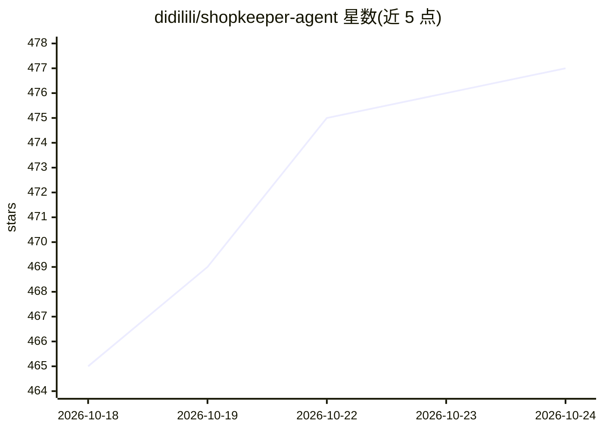

# didilili/shopkeeper-agent

⭐ 477 · Python · MIT · 推送 2026-10-14 · [GitHub](https://github.com/didilili/shopkeeper-agent) · [官网](https://didilili.github.io/ai-agents-from-zero/#/%E5%AE%9E%E6%88%98%E9%A1%B9%E7%9B%AE-%E7%94%B5%E5%95%86%E9%97%AE%E6%95%B0/0-%E5%89%8D%E8%A8%80) · 个人维护 · 中文 README

**面向 LangGraph 学习的电商数仓问数 AI Agent 全栈项目**

全栈可运行的「电商问数」智能体教学项目：先从教学数仓抽取表、字段、指标与字段取值构建元数据知识库，Qdrant 做语义召回、Elasticsearch 做全文检索、MySQL 存结构化元数据，再用 LangGraph 编排多阶段问数工作流，完成 SQL 生成、EXPLAIN 校验、错误修正、执行，经 FastAPI 与 SSE 流式返回 React 前端。配套 18 章免费教程与对应 Git 分支。声明不覆盖权限控制、多租户、SQL 审计等生产治理能力。Embedding 用 TEI 加载 BAAI/bge-large-zh-v1.5，默认接硅基流动 OpenAI 兼容接口。

## 筛选速览

| 维度 | 判定 | 备注 |
|---|---|---|
| AI 角色 | `ai-native` | 本体是模型或模型工具 |
| 许可风险 | `permissive` | MIT |
| 部署形态 | `self-host` | docker 或自建部署 |
| 模型依赖 | — | README 未给出锁定关系 |
| 硬件要求 | — | 无带数字的原话,不猜 |
| 安装摩擦 | `low` | 无编译、无系统依赖或容器化 |
| 成熟度 | — | 结构信号不足 |

## 能力要点

- 字段/指标/取值三类信息混合检索（Qdrant + Elasticsearch + MySQL）
- LangGraph 编排 SQL 生成、校验、修正、执行的完整闭环
- SSE 流式返回节点进度与查询结果，React 前端展示
- 18 章配套教程与章节分支对照学习

## 适用场景

- 系统学习 LangGraph 与 AI Agent 工程开发
- 在真实问数场景中理解 MySQL/Qdrant/ES 与 LLM 的协作
- 作为企业智能问数链路的起步代码二次开发

## 场景标签

`教程课程` `数据分析` · 领域:效率与自动化

## 证据(README 行号)

> L19: 它不是只调用一次大模型接口，也不是写几个 Prompt 演示 SQL 生成结果。这个项目围绕电商数仓问数场景，先构建元数据知识库，再做字段、指标、字段取值的混合检索，随后用 LangGraph 编排多阶段问数流程，完成 SQL 生
> L33: - 系统自动召回相关字段、指标和字段取值
> L36: - 以流式方式返回分析结果

## 星数曲线

2026-10-18 465 → 2026-10-24 477（+12）

---
*卡片 v1 · prompt 1.4 · 生成 2026-10-21 · 置信度 mid · 依据 README sha `dcde81afc81c` · [字段定义](../../DATASET.md)*
