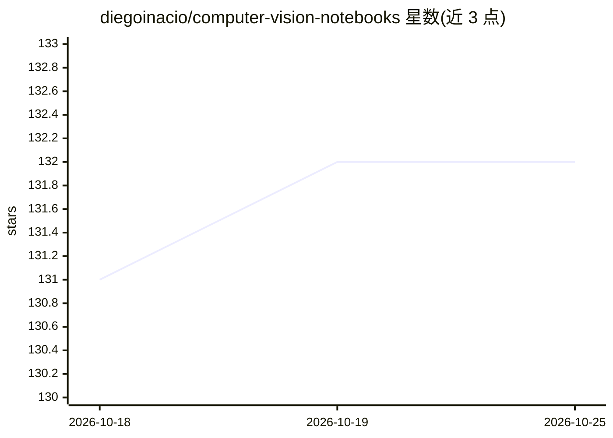

# diegoinacio/computer-vision-notebooks

⭐ 132 · Jupyter Notebook · MIT · 推送 2026-03-21 · [GitHub](https://github.com/diegoinacio/computer-vision-notebooks) · [官网](https://diegoinacio.github.io/computer-vision-notebooks-page/) · 个人维护

**计算机视觉与数字图像处理的 Python 教学笔记集**

作者个人维护的 Python notebook 配方集合，覆盖 Computer Vision 与 Digital Image Processing 基础概念的讲解与示例代码，定位为教学用途。提供更易浏览的 cookbook 发布页面，设有讨论区供提问与建议，并为更大合集 Python Notebooks for AI 的一部分，该合集还包含计算机科学、数据科学、机器学习等主题。README 未给出安装命令或运行说明。

## 筛选速览

| 维度 | 判定 | 备注 |
|---|---|---|
| AI 角色 | `ai-knowledge` | 知识聚合/清单类 |
| 许可风险 | `permissive` | MIT |
| 部署形态 | `None` |  |
| 模型依赖 | — | README 未给出锁定关系 |
| 硬件要求 | — | 无带数字的原话,不猜 |
| 安装摩擦 | `low` | 无编译、无系统依赖或容器化 |
| 成熟度 | — | 结构信号不足 |

## 能力要点

- 以 notebook 格式讲解计算机视觉与数字图像处理基础概念
- 提供 cookbook 网页版阅读方式
- 属于 Python Notebooks for AI 合集的一部分

## 适用场景

- 学习计算机视觉与数字图像处理基础概念
- 按 notebook 配方对照实现图像处理算法
- 配合 AI 相关笔记本合集扩展学习

## 场景标签

`教程课程` `图像视频处理` · 领域:学习与行业

## 证据(README 行号)

> L5: This is an `authorial set` of fundamental _Python recipes_ in notebook format. I started this project with the sole 
> L15: This project is part of the collection Python Notebooks for AI, which is a gathering of cookbooks on **Computer Sci

## 星数曲线

2026-10-18 131 → 2026-10-25 132（+1）

---
*卡片 v1 · prompt 1.4 · 生成 2026-10-22 · 置信度 high · 依据 README sha `4c295a177152` · [字段定义](../../DATASET.md)*
