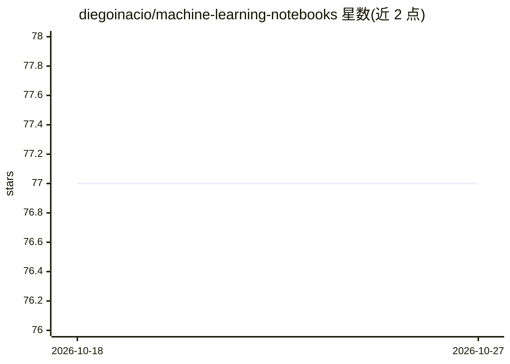

# diegoinacio/machine-learning-notebooks

⭐ 77 · Jupyter Notebook · MIT · 推送 2026-03-21 · [GitHub](https://github.com/diegoinacio/machine-learning-notebooks) · [官网](https://diegoinacio.github.io/machine-learning-notebooks-page/) · 个人维护

**机器学习与 AI 基础概念的 Python 笔记本教程集**

作者个人维护的 Python notebook 教程合集，以配方形式讲解机器学习与人工智能的基础概念，目的在于帮助读者清晰理解相关原理。笔记本文档通过配套的 cookbook 页面以更易读的形式发布，读者可在讨论区提问与提建议。该项目属于 Python Notebooks for AI 系列的一部分，该系列还涵盖计算机科学、数据科学、计算机视觉等主题的 cookbook。仓库本身不提供可安装的软件包或运行时，内容以阅读和学习为主。

## 筛选速览

| 维度 | 判定 | 备注 |
|---|---|---|
| AI 角色 | `ai-knowledge` | 知识聚合/清单类 |
| 许可风险 | `permissive` | MIT |
| 部署形态 | `None` |  |
| 模型依赖 | — | README 未给出锁定关系 |
| 硬件要求 | — | 无带数字的原话,不猜 |
| 安装摩擦 | `low` | 无编译、无系统依赖或容器化 |
| 成熟度 | — | 结构信号不足 |

## 能力要点

- 以 notebook 配方形式讲解 ML/AI 基础概念
- 配套 cookbook 页面用于发布与阅读笔记
- 属于 Python Notebooks for AI 系列（CS/DS/ML/CV 等主题）
- 提供讨论区用于提问与建议

## 适用场景

- 系统学习机器学习与 AI 的基础算法概念
- 查找特定 ML/AI 主题的 Python 代码示例
- 按 cookbook 形式浏览系列化教程内容

## 场景标签

`教程课程` · 领域:学习与行业

## 证据(README 行号)

> L5: This is an `authorial set` of fundamental _Python recipes_ in notebook format. I started this project with the sole 
> L15: This project is part of the collection Python Notebooks for AI, which is a gathering of cookbooks on **Computer Sci

## 星数曲线

2026-10-18 77 → 2026-10-27 77（+0）

---
*卡片 v1 · prompt 1.4 · 生成 2026-10-24 · 置信度 high · 依据 README sha `afccd2e684cc` · [字段定义](../../DATASET.md)*
