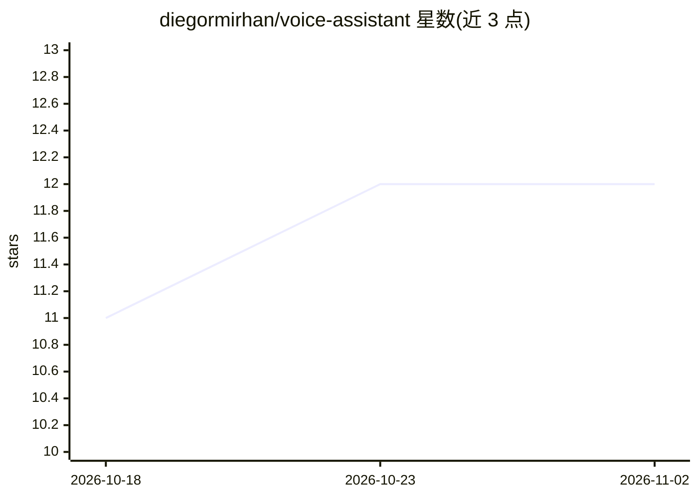

# diegormirhan/voice-assistant

⭐ 12 · Python · 推送 2026-08-11 · [GitHub](https://github.com/diegormirhan/voice-assistant) · 个人维护

**Windows 本地全双工视觉语音助手，全程离线运行**

面向 Windows 桌面用户的本地语音助手：支持随时打断（barge-in，中断延迟<100ms），说话瞬间截取桌面截图作为视觉上下文交给 LLM；管线由 VAD→STT（whisper.cpp）→LLM（llama.cpp，视觉+历史）→TTS（Piper，pt-BR 女声，逐句流式合成）组成，全部跑在 Vulkan 单 GPU 后端，明确不依赖 PyTorch/CUDA/WSL。目标端到端延迟<2 秒。二进制与模型首次运行从 Hugging Face 下载（约128MB+2.5~6GB），PyInstaller+Inno Setup 打包独立安装器。限制：仅 Windows 11，需 Vulkan 驱动 GPU，TTS 语音为 pt-BR。

## 筛选速览

| 维度 | 判定 | 备注 |
|---|---|---|
| AI 角色 | `ai-native` | 本体是模型或模型工具 |
| 许可风险 | `none` | — |
| 部署形态 | `desktop` | 安装包/桌面程序 |
| 模型依赖 | — | README 未给出锁定关系 |
| 硬件要求 | — | 无带数字的原话,不猜 |
| 安装摩擦 | `medium` | 含编译或系统依赖之一 |
| 成熟度 | — | 结构信号不足 |

## 能力要点

- 全双工 barge-in 打断，中断延迟目标<100ms，打断语音自动成为新问题
- 桌面截图作为 LLM 视觉上下文（可开关）
- whisper.cpp + llama.cpp 共用 Vulkan 后端，AMD/NVIDIA/Intel GPU 均可
- 首次运行自动从 Hugging Face 下载二进制与模型，两个模型配置档（4B/9B Q4 视觉模型）

## 适用场景

- 离线与电脑对话并口头获取回答，隐私数据不出本机
- 让助手‘看见’当前屏幕内容并据此回答
- 随时插话打断助手、连续对话

## 场景标签

`语音 Agent` `AI 助手` · 领域:对话与助手

## 证据(README 行号)

> L16: VoiceAssistant is a conversational assistant with **real full-duplex audio**:
> L39: - **GPU-accelerated STT + LLM** — whisper.cpp and llama.cpp on **Vulkan**, one
> L37: - **100% local / private** — no cloud, no API keys, everything runs on your

## 星数曲线

2026-10-18 11 → 2026-11-02 12（+1）

---
*卡片 v1 · prompt 1.4 · 生成 2026-11-01 · 置信度 high · 依据 README sha `7830055f65c9` · [字段定义](../../DATASET.md)*
