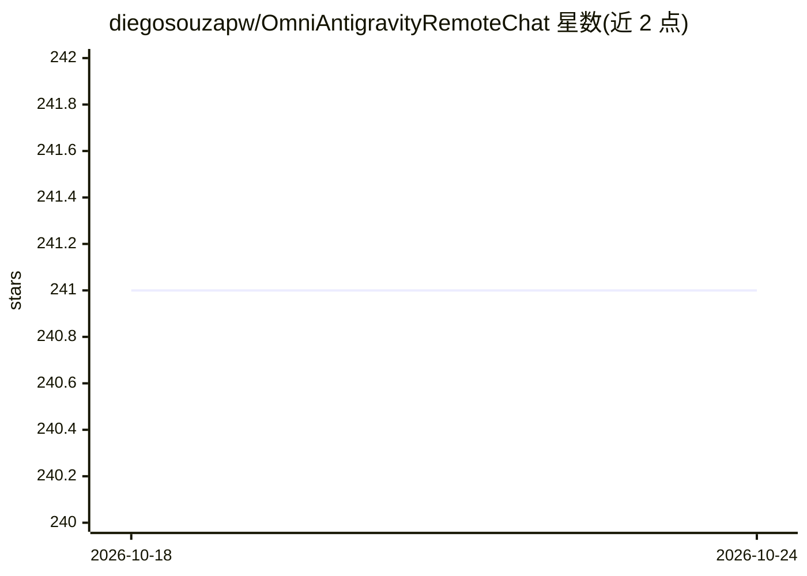

# diegosouzapw/OmniAntigravityRemoteChat

⭐ 241 · HTML · NOASSERTION · 推送 2026-05-23 · [GitHub](https://github.com/diegosouzapw/OmniAntigravityRemoteChat) · [官网](https://www.npmjs.com/package/omni-antigravity-remote-chat) · 个人维护

**手机浏览器远程镜像与操控 Antigravity AI 编程会话的工具**

通过 Chrome DevTools Protocol 连接 Antigravity（Windsurf）桌面端，将 AI 聊天 DOM 实时镜像到手机浏览器，支持发送消息、切换 Gemini/Claude/GPT 模型、多窗口管理、远程批准 CLI 指令，并提供文件浏览、终端、Git、截图时间线等 7 个移动面板。以 npx 一条命令或 npm 全局安装、Docker 方式运行，需先以 --remote-debugging-port 启动 Antigravity。支持 Cloudflare/Pinggy/ngrok 隧道与 Telegram 通知，默认密码认证与 HTTPS。

## 筛选速览

| 维度 | 判定 | 备注 |
|---|---|---|
| AI 角色 | `ai-ecosystem` | LLM/agent 周边工具 |
| 许可风险 | `none` | NOASSERTION |
| 部署形态 | `self-host` | docker 或自建部署 |
| 模型依赖 | — | README 未给出锁定关系 |
| 硬件要求 | — | 无带数字的原话,不猜 |
| 安装摩擦 | `low` | 无编译、无系统依赖或容器化 |
| 成熟度 | — | 结构信号不足 |

## 能力要点

- CDP 连接桌面端，实时镜像聊天并回传操作（<100ms WebSocket 同步）
- 手机端切换模型与管理多个 Antigravity 窗口
- 远程自动检测与一键批准/拒绝 CLI 指令，含建议队列模式
- 移动工作区含 Files/Terminal/Git/Assist/Stats/Timeline/Screen 七个面板

## 适用场景

- 离开桌面后在手机上继续查看和回复 AI 编程会话
- 远程批准 AI 助手请求执行的命令行指令
- 从手机浏览项目文件、跑终端命令和做 Git 操作

## 场景标签

 · 领域:开发者工具/AI 会话远程控制

## 证据(README 行号)

> L121: The server connects to Antigravity via the **Chrome DevTools Protocol (CDP)**, captures the chat DOM in real-time,
> L98: |🤖|**Model switching**|Toggle between Gemini, Claude, GPT from a mobile dropdown|

## 星数曲线

2026-10-18 241 → 2026-10-24 241（+0）

---
*卡片 v1 · prompt 1.4 · 生成 2026-10-22 · 置信度 high · 依据 README sha `9b8eb50ce23e` · [字段定义](../../DATASET.md)*
