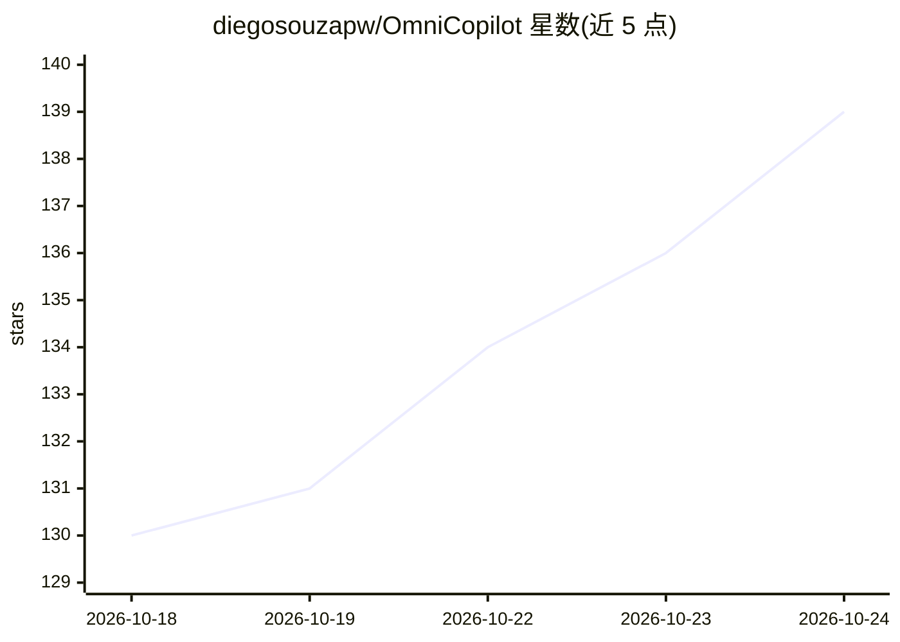

# diegosouzapw/OmniCopilot

⭐ 139 · TypeScript · MIT · 推送 2026-09-03 · [GitHub](https://github.com/diegosouzapw/OmniCopilot) · [官网](https://github.com/diegosouzapw/OmniRoute) · 个人维护

**把 1200+ 模型接入 VS Code Copilot Chat 的扩展**

VS Code 扩展（亦发布于 Open VSX，支持 Cursor/Windsurf/VSCodium 等），通过 VS Code 原生 language-model provider API 将 OmniRoute 服务器（340+ 提供商，90+ 免费层）上的 1200+ 模型注入 Copilot Chat 的模型选择器，保留 agent mode、tool calling、MCP 与视觉附件能力，并支持 combos 自动故障切换；API key 存于 VS Code SecretStorage。需先安装并运行 OmniRoute 服务器（npm 全局安装，默认 localhost:20128）。限制：行内补全与 embeddings 功能仍需 GitHub Copilot；VS Code 1.104+。

## 筛选速览

| 维度 | 判定 | 备注 |
|---|---|---|
| AI 角色 | `ai-ecosystem` | LLM/agent 周边工具 |
| 许可风险 | `permissive` | MIT |
| 部署形态 | `library` | 以包/库形式分发 |
| 模型依赖 | local-ok | 支持本地模型 |
| 硬件要求 | — | 无带数字的原话,不猜 |
| 安装摩擦 | `low` | 无编译、无系统依赖或容器化 |
| 成熟度 | `idea` | |

## 能力要点

- 通过 OmniRoute 单端点聚合 340+ 提供商、1200+ 模型到模型选择器
- 接入 VS Code 原生 provider API，保留 agent mode/tool calling/MCP/视觉
- combos（优先级/轮询/成本优化等）作为常规模型提供自动故障切换
- 一条命令为 Codex CLI、Claude Code、Cline、Cursor 等生成接入配置

## 适用场景

- 不订阅 Copilot 也能在 VS Code 中免费使用多种模型对话与 agent mode
- 把自建或远程 OmniRoute 服务器的模型接入现有 Copilot Chat 工作流
- 统一管理多个 AI 提供商并在日常编码工具间共享接入配置

## 场景标签

`模型网关` `AI 助手` · 领域:Agent 开发

## 证据(README 行号)

> L21: - **1200+ models, one picker.** OmniRoute unifies 340+ providers (OpenAI-compatible, Anthropic, Gemini, Ollama, loc
> L22: - **Agent mode, tool calling, MCP, instructions — all of it still works.** This plugs into VS Code's native languag

## 星数曲线

2026-10-18 130 → 2026-10-24 139（+9）

---
*卡片 v1 · prompt 1.4 · 生成 2026-10-22 · 置信度 mid · 依据 README sha `e643dfe93dcd` · [字段定义](../../DATASET.md)*
