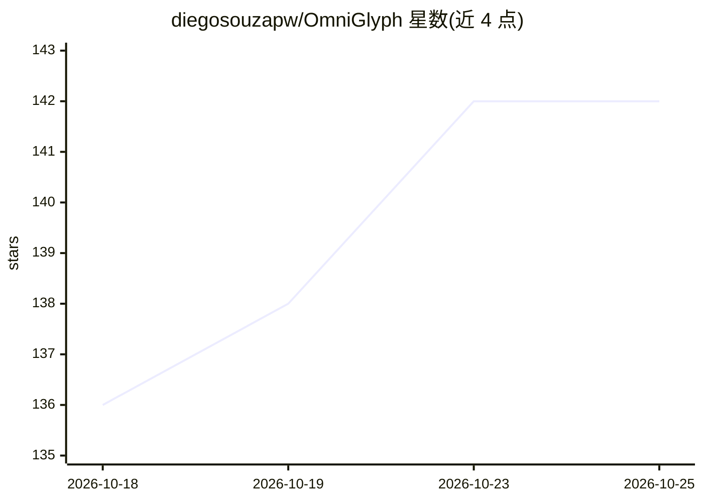

# diegosouzapw/OmniGlyph

⭐ 143 · TypeScript · MIT · 推送 2026-10-20 · [GitHub](https://github.com/diegosouzapw/OmniGlyph) · [官网](https://github.com/diegosouzapw/OmniRoute) · 个人维护

**本地代理：把 LLM 上下文渲染为 PNG 图像以削减 token 费用**

面向按 token 计费的 LLM 用户的本地代理与 npm 库：在请求离开本机前，把系统提示、工具文档、旧历史等静态内容重排渲染为 1568×728 的 1-bit PNG 页面，利用图像按尺寸计费的规则降低 token 开销。内置按精确计费公式判断是否值得转换的盈利门控，读图基准未通过的模型被 fail-closed 门控拦截（当前仅 Fable 5 通过）。提供 CLI、代理、本地仪表盘与离线导出模式，Node ≥18，纯 JS 运行时，支持 Cloudflare Workers。

## 筛选速览

| 维度 | 判定 | 备注 |
|---|---|---|
| AI 角色 | `ai-ecosystem` | LLM/agent 周边工具 |
| 许可风险 | `permissive` | MIT |
| 部署形态 | `library` | 以包/库形式分发 |
| 模型依赖 | locked-api |  |
| 硬件要求 | — | 无带数字的原话,不猜 |
| 安装摩擦 | `low` | 无编译、无系统依赖或容器化 |
| 成熟度 | `idea` | |

## 能力要点

- 请求前将系统提示/工具文档/旧历史渲染为密集 PNG 页面
- 按提供商真实图像计费公式精确判断是否转换的盈利门控
- 读图基准未通过的模型被 fail-closed 门控拦截，附带基准回执
- 支持库形式调用与离线 export：渲染文件夹/管道文本为图像页供任意聊天粘贴

## 适用场景

- Claude Code 会话中降低 API 账单的 token 开销
- 订阅会话下让 token 限额覆盖更多内容
- 把代码文件夹或日志渲染成图像页粘贴到支持图片上传的聊天工具

## 场景标签

`模型网关` · 领域:Agent 开发

## 证据(README 行号)

> L99: Every long-running agent session drags the same dead weight on every request: the system prompt, tool docs, and old
> L103: - **Private & local-first** — the rewrite happens on `127.0.0.1`; nothing extra is sent anywhere.

## 星数曲线

2026-10-18 136 → 2026-10-25 142（+6）

---
*卡片 v1 · prompt 1.4 · 生成 2026-10-23 · 置信度 high · 依据 README sha `58b465f48202` · [字段定义](../../DATASET.md)*
