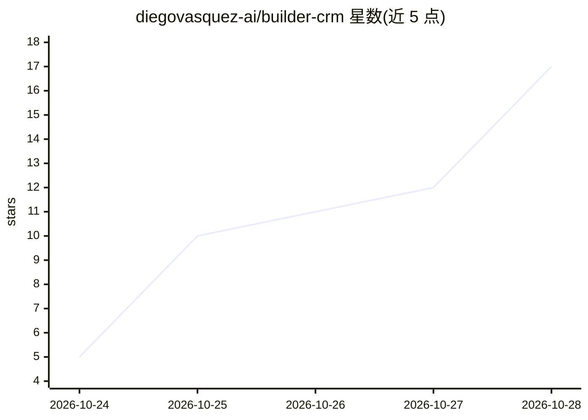

# diegovasquez-ai/builder-crm

⭐ 20 · TypeScript · MIT · 推送 2026-10-26 · [GitHub](https://github.com/diegovasquez-ai/builder-crm) · 个人维护

**给代理机构的多渠道 CRM：每客户一实例，内置 AI 销售代理**

Next.js + TypeScript 自托管 CRM，将 WhatsApp、Instagram、Messenger 消息聚合到一个收件箱；AI 代理（经 OpenRouter，模型可配）读取对话历史、回复消息、更新联系人档案、推进看板阶段并转人工。设计为每客户一个实例：客户定制放在 modules/ 与 config/，通过 Claude Code 技能用自然语言完成适配、构建、部署与验证。本地模式内嵌 WebAssembly Postgres 免账号试用；正式实例需 Supabase 或自托管 Postgres+GoTrue，部署支持 Coolify/Vercel/docker compose。无 OpenRouter 密钥时 CRM 功能仍可用，仅代理不回复。

## 筛选速览

| 维度 | 判定 | 备注 |
|---|---|---|
| AI 角色 | `ai-enhanced` | 去掉 AI 部分产品仍成立 |
| 许可风险 | `permissive` | MIT |
| 部署形态 | `self-host` | docker 或自建部署 |
| 模型依赖 | locked-api |  |
| 硬件要求 | — | 无带数字的原话,不猜 |
| 安装摩擦 | `low` | 无编译、无系统依赖或容器化 |
| 成熟度 | — | 结构信号不足 |

## 能力要点

- 三渠道统一收件箱（经 Zernio）+ 看板管线 + 代理自动推进阶段
- AI 代理可回复、更新档案、记录活动、暂停转人工
- 客户定制隔离在 modules/config，经 Claude Code 技能流程适配部署
- npm run local 内嵌 Postgres，免账号两分钟本地试用

## 适用场景

- 代理机构为每个客户交付一个可定制 CRM 实例
- 统一收发 WhatsApp/Instagram/Messenger 消息并让 AI 代理跟单
- 用 Claude Code 以自然语言为客户构建垂直模块（如房产）并部署

## 场景标签

 · 领域:企业应用/CRM

## 证据(README 行号)

> L24: - **Agente de IA** (OpenRouter, modelo por variable): lee el historial, responde por
> L78: funciona igual (los mensajes entran a la bandeja y crean el contacto), solo que nadie

## 星数曲线

2026-10-24 5 → 2026-10-28 17（+12）

---
*卡片 v1 · prompt 1.4 · 生成 2026-10-28 · 置信度 high · 依据 README sha `ae72ec4b0996` · [字段定义](../../DATASET.md)*
