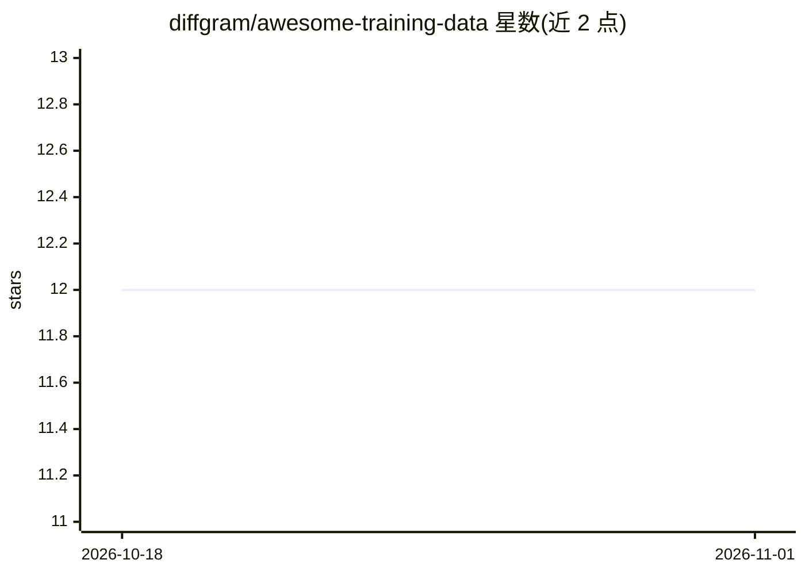

# diffgram/awesome-training-data

⭐ 12 · 推送 2026-06-12 · [GitHub](https://github.com/diffgram/awesome-training-data) · 组织维护

**训练数据工具与平台策展清单（标注、数据质量、工作流）**

由 Diffgram 维护的 awesome 类型清单，收录训练数据相关资源：开源平台（Diffgram、CVAT）、数据完整性与 agent 生成数据工具（dos-kernel、Cleanlab）、闭源商业平台（Kili、Supervisely、Labelbox、Label Studio 等），并汇集社区、书籍与博客链接。条目按开源/闭源/社区/书籍/博客分类组织，接受社区贡献。不提供软件安装，仅为目录式索引。

## 筛选速览

| 维度 | 判定 | 备注 |
|---|---|---|
| AI 角色 | `ai-knowledge` | 知识聚合/清单类 |
| 许可风险 | `none` | — |
| 部署形态 | `None` |  |
| 模型依赖 | — | README 未给出锁定关系 |
| 硬件要求 | — | 无带数字的原话,不猜 |
| 安装摩擦 | `low` | 无编译、无系统依赖或容器化 |
| 成熟度 | — | 结构信号不足 |

## 能力要点

- 覆盖数据标注、发现与工作流的分类清单
- 区分开源平台与闭源商业平台条目
- 包含训练数据完整性与 agent 生成数据验证工具分类

## 适用场景

- 为机器学习项目寻找数据标注平台
- 对比开源与商业训练数据工具
- 查找数据质量与标签错误检测工具

## 场景标签

`精选清单` · 领域:学习与行业

## 证据(README 行号)

> L2: Curated list of Awesome Training Data! (Data Labeling, Annotation, Discovery, Workflow etc)
> L8: # Open Source Platforms

## 星数曲线

2026-10-18 12 → 2026-11-01 12（+0）

---
*卡片 v1 · prompt 1.4 · 生成 2026-11-01 · 置信度 high · 依据 README sha `8f775e613864` · [字段定义](../../DATASET.md)*
