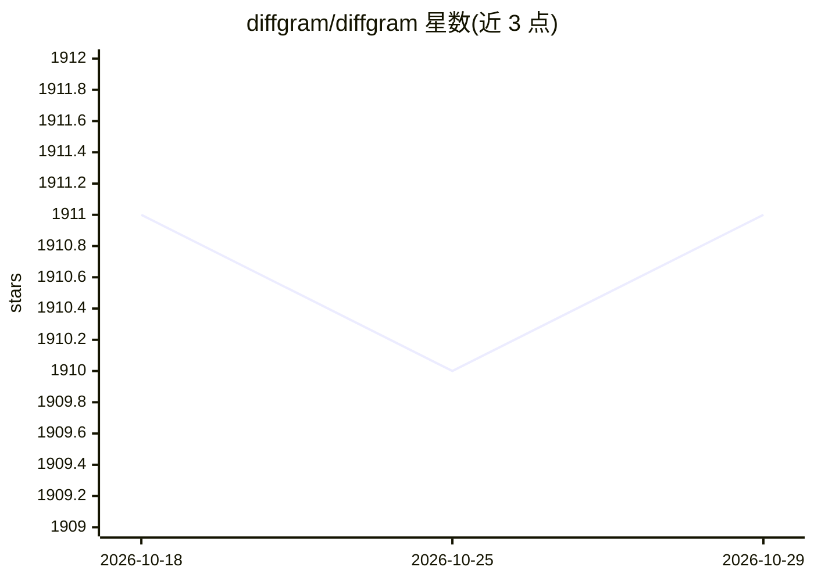

# diffgram/diffgram

⭐ 1,911 · Python · NOASSERTION · 推送 2026-06-22 · [GitHub](https://github.com/diffgram/diffgram) · [官网](https://diffgram.com) · 组织维护

**面向 AI 数据的标注与数据工作流平台（AI Datastore）**

自托管的 AI 数据存储与标注平台：管理 Schema、BLOB 与预测数据，提供多模态人工监督标注（图像、视频、3D、文本、音频、地理空间、对话/LLM 预览等）、数据在 AI 应用间流转的工作流，以及可视化 UI Catalog。用户自行安装并控制数据。2023 年起采用 Diffgram 许可 v2（DLv2），含贡献者许可与 MSA 商业条款；README 同时推介同团队的开源项目 DOS 与 fak（agent 信任与治理内核）。

## 筛选速览

| 维度 | 判定 | 备注 |
|---|---|---|
| AI 角色 | `ai-ecosystem` | LLM/agent 周边工具 |
| 许可风险 | `none` | NOASSERTION |
| 部署形态 | `library` | 以包/库形式分发 |
| 模型依赖 | — | README 未给出锁定关系 |
| 硬件要求 | — | 无带数字的原话,不猜 |
| 安装摩擦 | `low` | 无编译、无系统依赖或容器化 |
| 成熟度 | — | 结构信号不足 |

## 能力要点

- 支持多模态数据标注：图像/视频/3D/文本/音频/GeoSpatial/对话与 LLM（预览）
- 数据工作流与 UI Catalog，用于 AI 应用间数据流转与可视化浏览
- 自托管部署，用户控制自己的数据
- 706 项测试（E2E、单元等）

## 适用场景

- 团队对图像、视频等多模态训练数据做人工标注
- 合规管理含 PII 的 AI 数据，供 AI 应用统一存取
- 通过 UI 可视化浏览与检查 AI 数据存储

## 场景标签

 · 领域:AI 数据/标注平台

## 证据(README 行号)

> L15: The AI Datastore for Schemas, BLOBs, and Predictions. Use with your apps or integrate built-in Human Supervision, D
> L22: * **Human Supervision (Data Labeling)** - Label all media types and scale your annotation.
> L23: * **AI Data Application Workflow** - Move data between your AI Apps and control your AI through a friendly UI/UX ex

## 星数曲线

2026-10-18 1,911 → 2026-10-29 1,911（+0）

---
*卡片 v1 · prompt 1.4 · 生成 2026-10-21 · 置信度 low · 依据 README sha `66220a3eacb8` · [字段定义](../../DATASET.md)*
