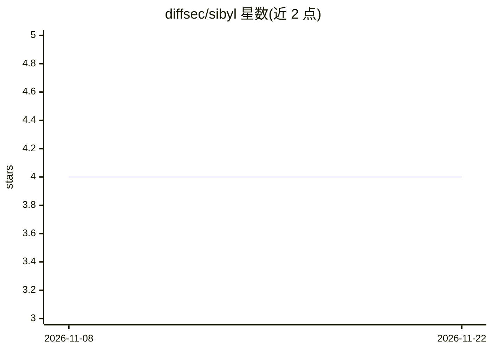

# diffsec/sibyl

⭐ 4 · Go · AGPL-3.0 · 推送 2026-11-21 · [GitHub](https://github.com/diffsec/sibyl) · 个人维护

**一体化私有 AI 推理服务器：把 GPU 主机变成本地 LLM 服务**

Sibyl 将一台或多 GPU 计算机部署为私有推理服务器，基于 Fedora bootc 不可变宿主镜像，从 USB 或网络安装。内置 llama.cpp（经 llama-swap 按需加载/切换 GGUF 模型，支持单模型跨多 GPU 或每卡一模型）、OpenAI/Anthropic/Ollama 兼容 API（TLS 加密、按程序密钥）、按规则路由本地/云端模型的路由器、Open WebUI 聊天界面与模型管理（搜索 Hugging Face、按 GPU 筛选文件、断点续传与校验和）。磁盘 LUKS2+TPM2 加密，宿主可一键更新回滚。当前为 pre-alpha；NVIDIA 与 Intel 变体未在硬件上测试；AGPLv3 许可并提供商业许可。

## 筛选速览

| 维度 | 判定 | 备注 |
|---|---|---|
| AI 角色 | `ai-ecosystem` | LLM/agent 周边工具 |
| 许可风险 | `dual` | AGPL-3.0 |
| 部署形态 | `None` |  |
| 模型依赖 | local-ok | 支持本地模型 |
| 硬件要求 | — | 无带数字的原话,不猜 |
| 安装摩擦 | `medium` | 含编译或系统依赖之一 |
| 成熟度 | `idea` | |

## 能力要点

- llama.cpp 经 llama-swap 提供按需加载与多 GPU 模型调度
- 同时提供 OpenAI、Anthropic 与 Ollama 兼容 API，带 TLS 与按程序密钥
- 规则化模型路由器可按请求选择本地模型或云服务商，并设预算
- Fedora bootc 安全宿主：SELinux 强制、Secure Boot、LUKS2+TPM2 磁盘加密

## 适用场景

- 在本地 GPU 主机上搭建不外发数据的私有 LLM 服务
- 为现有 OpenAI/Ollama 客户端提供统一的多模型 API 入口
- 按规则把含敏感信息的请求保留在本地模型处理
- 在服务器上搜索、筛选并管理 Hugging Face 模型下载

## 场景标签

`推理引擎` `模型网关` · 领域:Agent 开发

## 证据(README 行号)

> L3: Sibyl is an all-in-one inference server. It turns a computer with one or more GPUs into a private AI server. You ins
> L9: - Local models. llama.cpp serves GGUF models through llama-swap, which loads and swaps models on demand. One model c
> L10: - Standard APIs. Sibyl serves an OpenAI-compatible API (`/v1`), an Anthropic Messages API and an Ollama-compatible 

## 星数曲线

2026-11-08 4 → 2026-11-22 4（+0）

---
*卡片 v1 · prompt 1.4 · 生成 2026-11-21 · 置信度 high · 依据 README sha `fc310da089f9` · [字段定义](../../DATASET.md)*
