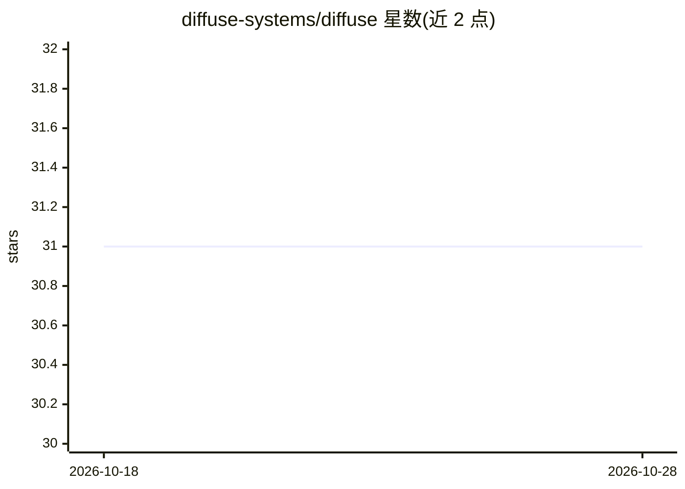

# diffuse-systems/diffuse

⭐ 31 · Rust · AGPL-3.0 · 推送 2026-08-05 · [GitHub](https://github.com/diffuse-systems/diffuse) · [官网](https://diffuse-systems.github.io/diffuse/) · 个人维护

**端到端加密的点对点分布式 LLM 推理网络与聊天客户端**

将大语言模型按层切分到全球志愿节点上运行：用户本机执行分词与前几层，仅加密的激活值在节点间流转（X25519 + ChaCha20-Poly1305 逐跳加密），提示词明文不出本机。面向不能信任云端的人群（记者、受保密约束的医生等）。提供零配置聊天客户端与一键安装脚本，也可用 diffuse host 贡献本机算力；NAT 后节点经加密中继参与。守护进程为 Rust，模型执行在独立 Python worker（PyTorch/Transformers）。自述为公开互联网上运行的原型，不隐藏‘你在对话’这一事实，不默认隐藏 IP。

## 筛选速览

| 维度 | 判定 | 备注 |
|---|---|---|
| AI 角色 | `ai-native` | 本体是模型或模型工具 |
| 许可风险 | `viral` | AGPL-3.0 |
| 部署形态 | `desktop` | 安装包/桌面程序 |
| 模型依赖 | — | README 未给出锁定关系 |
| 硬件要求 | — | 无带数字的原话,不猜 |
| 安装摩擦 | `medium` | 含编译或系统依赖之一 |
| 成熟度 | `idea` | |

## 能力要点

- 模型按层垂直切分跨多台机器运行，节点故障自动再复制自愈
- 提示词明文留在本机，节点间逐跳端到端加密（X25519/ChaCha20-Poly1305）
- 无中心服务器：签名 gossip 发现节点，节点自行测量硬件承担切片
- NAT/防火墙后节点经加密中继仍可贡献算力

## 适用场景

- 在不信任云服务的前提下与 LLM 对话，避免提示词被记录
- 用家里旧笔记本或工作站贡献算力、托管模型切片
- 多台小机器协作运行单机放不下的大模型

## 场景标签

`聊天机器人` `推理引擎` · 领域:对话与助手

## 证据(README 行号)

> L9: Large language models running on a peer-to-peer network of ordinary machines.
> L68: That is all. Zero configuration: `diffuse chat` joins the network, finds a model, and streams the answer back token

## 星数曲线

2026-10-18 31 → 2026-10-28 31（+0）

---
*卡片 v1 · prompt 1.4 · 生成 2026-10-26 · 置信度 high · 依据 README sha `d5792226a4ac` · [字段定义](../../DATASET.md)*
