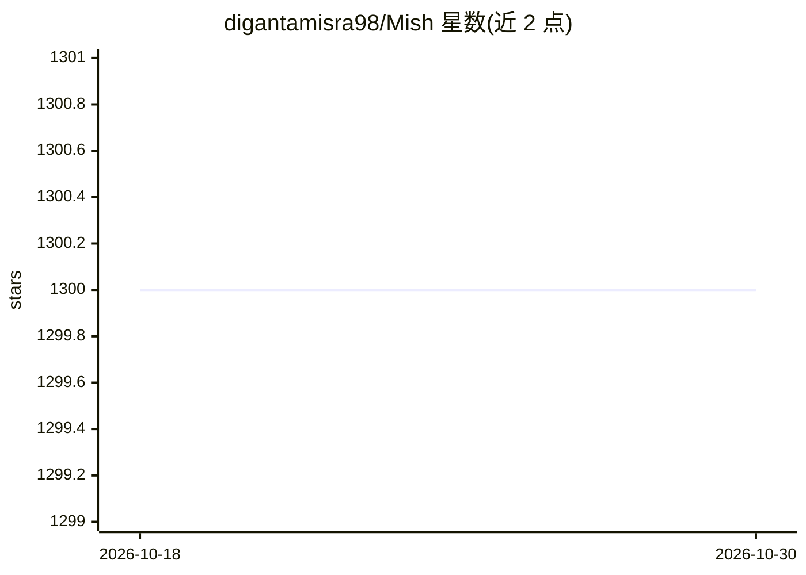

# digantamisra98/Mish

⭐ 1,300 · Jupyter Notebook · MIT · 推送 2026-07-20 · [GitHub](https://github.com/digantamisra98/Mish) · [官网](https://www.bmva-archive.org.uk/bmvc/2020/assets/papers/0928.pdf) · 个人维护

**自正则非单调神经网络激活函数，BMVC 2020 官方仓库**

论文 "Mish: A Self Regularized Non-Monotonic Neural Activation Function"（BMVC 2020）的官方仓库：提出 Mish 激活函数并给出数学性质（C∞ 连续、最小值约 -0.30884），配合 ImageNet、MS-COCO、MNIST/CIFAR10 等基准数据，展示与 ReLU/Swish 的准确率与损失曲面对比。面向深度学习研究者和模型开发者。README 记录其被 PyTorch、MXNet、TensorFlow JS、MONAI 等框架收录的变更日志，并提供 CUDA 加速版本、硬件性能基准等链接。

## 筛选速览

| 维度 | 判定 | 备注 |
|---|---|---|
| AI 角色 | `ai-native` | 本体是模型或模型工具 |
| 许可风险 | `permissive` | MIT |
| 部署形态 | `None` |  |
| 模型依赖 | — | README 未给出锁定关系 |
| 硬件要求 | — | 无带数字的原话,不猜 |
| 安装摩擦 | `medium` | 含编译或系统依赖之一 |
| 成熟度 | — | 结构信号不足 |

## 能力要点

- 提出 Mish 激活函数及其数学定义（C∞ 连续、最小值 ≈-0.30884）
- 提供 ImageNet / MS-COCO / MNIST / CIFAR10 上与 ReLU、Swish 的对比基准
- 提供独立 CUDA 加速版本与损失曲面可视化工具
- 被 PyTorch（1.9 起）、MXNet、TensorFlow JS、MONAI 等框架收录

## 适用场景

- 为分类/检测网络替换激活函数并查阅基准数据
- 研究非单调激活函数的损失曲面与优化性质
- 复现 BMVC 2020 论文实验结果

## 场景标签

 · 领域:深度学习/神经网络组件

## 证据(README 行号)

> L1: Mish: Self Regularized Non-Monotonic Activation Function
> L17:  BMVC 2020 (Official Paper)
> L49:  * [26/05] 🔥 Mish is added to PyTorch. Will be added in PyTorch 1.9. 🔥

## 星数曲线

2026-10-18 1,300 → 2026-10-30 1,300（+0）

---
*卡片 v1 · prompt 1.4 · 生成 2026-10-21 · 置信度 high · 依据 README sha `a2c992fc25a6` · [字段定义](../../DATASET.md)*
