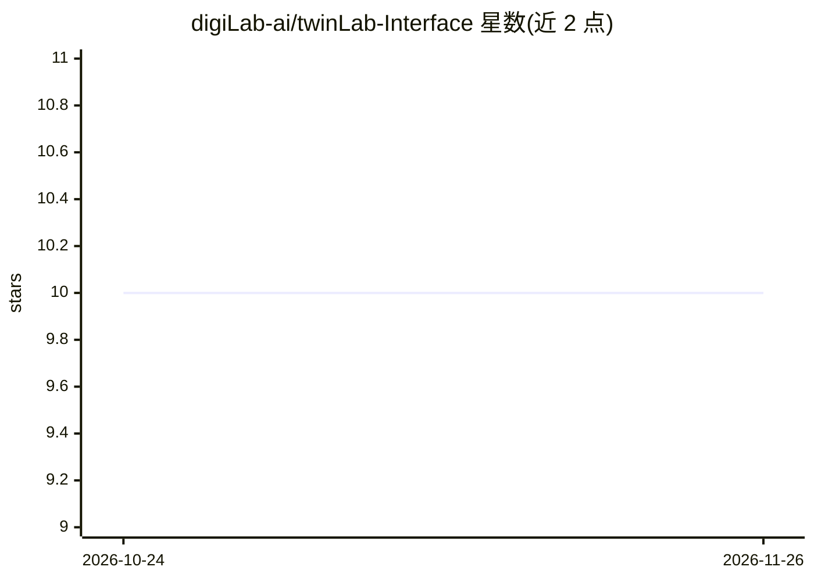

# digiLab-ai/twinLab-Interface

⭐ 10 · Python · 推送 2026-02-09 · [GitHub](https://github.com/digiLab-ai/twinLab-Interface) · [官网](https://twinlab.ai/) · 组织维护

**面向工程师的云端概率机器学习仿真代理接口**

digiLab 的 twinLab Python 接口：连接云端概率机器学习服务，用户可基于仿真、实验装置或传感器网络数据构建实时仿真代理模型，进行预测、推荐、优化与物理参数校准。内置不确定性量化（UQ），支持稀疏或噪声数据。安装需 pip，使用前需申请试用获取用户名与 API key，通过脚本或 .env 文件配置凭证。

## 筛选速览

| 维度 | 判定 | 备注 |
|---|---|---|
| AI 角色 | `ai-native` | 本体是模型或模型工具 |
| 许可风险 | `none` | — |
| 部署形态 | `library` | 以包/库形式分发 |
| 模型依赖 | — | README 未给出锁定关系 |
| 硬件要求 | — | 无带数字的原话,不猜 |
| 安装摩擦 | `low` | 无编译、无系统依赖或容器化 |
| 成熟度 | — | 结构信号不足 |

## 能力要点

- 从数据构建实时仿真代理模型
- 内置不确定性量化（UQ）
- 支持预测、推荐、优化与物理参数校准
- 提供 .env 文件自动读取 API key 的配置方式

## 适用场景

- 为工程仿真建立代理模型加速设计探索
- 基于传感器数据校准物理参数
- 在稀疏或噪声数据下进行带置信度的预测与优化

## 场景标签

 · 领域:工程/科学计算

## 证据(README 行号)

> L5: twinLab is a tool for augmenting engineering workflows with Probabilistic Machine Learning. It enables users to quic
> L16: pip install twinlab

## 星数曲线

2026-10-24 10 → 2026-11-26 10（+0）

---
*卡片 v1 · prompt 1.4 · 生成 2026-11-19 · 置信度 high · 依据 README sha `25fb4e50fab9` · [字段定义](../../DATASET.md)*
