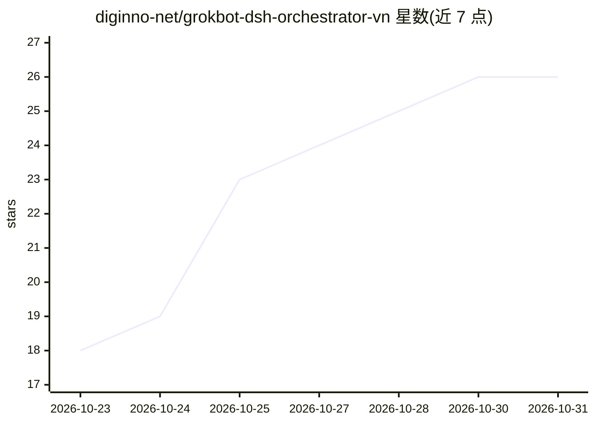

# diginno-net/grokbot-dsh-orchestrator-vn

⭐ 26 · Shell · NOASSERTION · 推送 2026-10-21 · [GitHub](https://github.com/diginno-net/grokbot-dsh-orchestrator-vn) · 组织维护

**让 Grok Bot 当调度层、DeepSeek Harness 做廉价 worker 的编排方案（含技能/脚本/配置）**

面向越南中小企业主与运维团队的 agent 编排仓库：把 Grok Bot 作为调度层（理解需求、拆分、审核、决策），将读 CSV、写脚本、生成草稿等任务交给 DeepSeek Harness（dsh）在沙盒目录中以低价模型 deepseek-v4.1-flash 执行，经 OpenCode Go 或 9router 调用，单任务成本约 0.004–0.02 美元。仓库提供 Grok Bot 技能文件（SKILL.md）、模型切换配置补丁、headless 运行辅助脚本、示例数据与越南语使用文档。dsh 处于 developer preview，无成本与性能承诺。

## 筛选速览

| 维度 | 判定 | 备注 |
|---|---|---|
| AI 角色 | `ai-ecosystem` | LLM/agent 周边工具 |
| 许可风险 | `none` | NOASSERTION |
| 部署形态 | `library` | 以包/库形式分发 |
| 模型依赖 | — | README 未给出锁定关系 |
| 硬件要求 | — | 无带数字的原话,不猜 |
| 安装摩擦 | `low` | 无编译、无系统依赖或容器化 |
| 成熟度 | — | 结构信号不足 |

## 能力要点

- Grok Bot 调度 + dsh worker 的双层架构，worker 限定在沙盒目录 workspace-write
- 含 SKILL.md 技能、模型切换 config 补丁、run-dsh.sh 辅助脚本与示例
- 附 6 项单次运行的成本/耗时基准（$0.004–0.017/任务）
- 面向越南 SME 的 9 个使用场景文档（对账、Lark 周报、订单 CSV 处理等）

## 适用场景

- 把读 CSV、写脚本、生成报告草稿等廉价任务下放给低价模型执行，节省配额
- 让 Grok Bot 保持敏感操作（浏览器、发消息、资金决策）只做调度与审核
- 越南中小企业按文档示例对账、生成周报与处理订单数据

## 场景标签

`Agent 框架` `工作流自动化` · 领域:Agent 开发

## 证据(README 行号)

> L17:     U["👤 Bạn (chat với Grok Bot)"] --> G["🧠 Grok Bot điều phối: hiểu việc, chia nhỏ, kiểm tra, duyệt gử
> L22: - **Grok Bot** giữ mọi thứ nhạy cảm: browser, đăng nhập, gửi tin, ghi dữ liệu, quyết định.
> L23: - **dsh** chỉ làm trong một thư mục tạm (sandbox `workspace-write`), trả về file + log JSON để Grok Bot kiểm tra lạ

## 星数曲线

2026-10-23 18 → 2026-10-31 26（+8）

---
*卡片 v1 · prompt 1.4 · 生成 2026-10-27 · 置信度 mid · 依据 README sha `f800833f7edb` · [字段定义](../../DATASET.md)*
