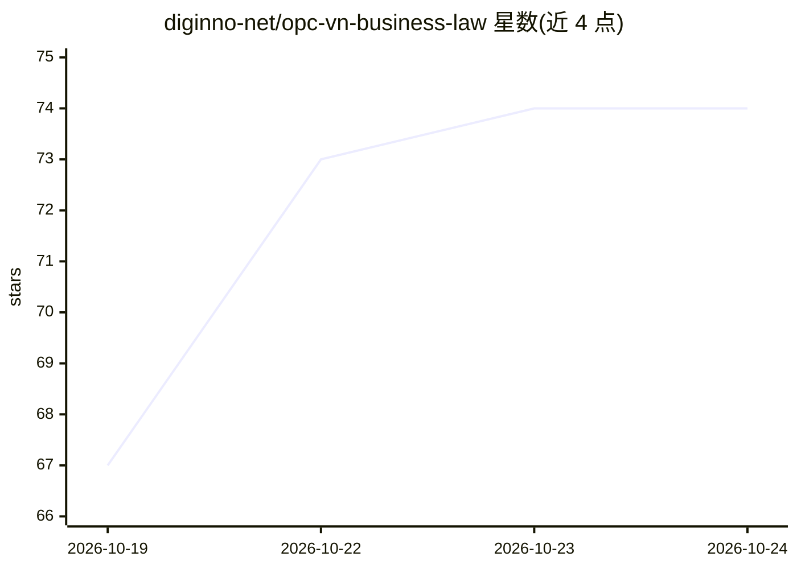

# diginno-net/opc-vn-business-law

⭐ 75 · Python · NOASSERTION · 推送 2026-10-18 · [GitHub](https://github.com/diginno-net/opc-vn-business-law) · [官网](https://diginno.net) · 组织维护

**越南一人公司法律–税务–会计参考 Skill，供 AI agent 调用**

面向越南个体户、自由职业者、新公司创办者与代理会计的 agent 技能包：以 SKILL.md 定义回答流程与 disclaimer，配 9 个专题参考文件（经营主体比较、治理、会计、税务、转换 12 步等）、核对清单模板与一个税收比较 Python 脚本。安装方式为复制目录或 git clone 到 Claude Code/Codex/OpenCode 等 agent 的 skills 目录。声明仅为参考资料而非法律意见，不覆盖诉讼、M&A 等范围；数据更新至 17/10/2026，内容 CC BY 4.0、脚本 MIT。

## 筛选速览

| 维度 | 判定 | 备注 |
|---|---|---|
| AI 角色 | `ai-knowledge` | 知识聚合/清单类 |
| 许可风险 | `none` | NOASSERTION |
| 部署形态 | `None` |  |
| 模型依赖 | — | README 未给出锁定关系 |
| 硬件要求 | — | 无带数字的原话,不猜 |
| 安装摩擦 | `low` | 无编译、无系统依赖或容器化 |
| 成熟度 | — | 结构信号不足 |

## 能力要点

- SKILL.md 定义回答流程、原则、答句模板与 disclaimer
- 9 个专题参考文件区分现行法规与 2026 草案状态
- 附带税收比较脚本 so_sanh_thue.py（含自测命令）
- 适配 Claude Code / Codex / OpenCode 等 harness 的 skills 目录

## 适用场景

- 让 AI agent 回答越南个体户与一人公司的法律、税务、会计问题
- 获取个体户转公司的 12 步转换核对清单
- 比较按营收百分比与申报法两种税务方式

## 场景标签

 · 领域:法律/税务参考知识

## 证据(README 行号)

> L3: **Skill tham khảo pháp lý – thuế – kế toán cho doanh nghiệp một người tại Việt Nam.**
> L19: |`SKILL.md`|Hướng dẫn cho AI: quy trình, nguyên tắc, mẫu câu trả lời, disclaimer|
> L41: |Claude Code|`~/.claude/skills/opc-vn-business-law/`|

## 星数曲线

2026-10-19 67 → 2026-10-24 74（+7）

---
*卡片 v1 · prompt 1.4 · 生成 2026-10-24 · 置信度 high · 依据 README sha `14fa95c7d2fa` · [字段定义](../../DATASET.md)*
