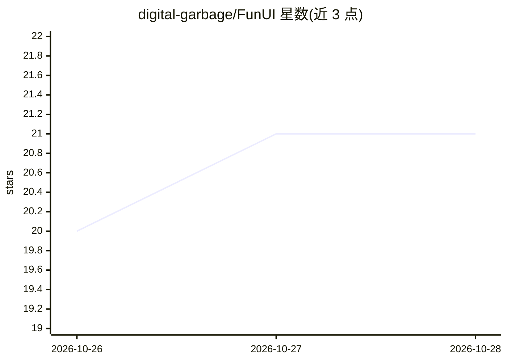

# digital-garbage/FunUI

⭐ 21 · Python · GPL-3.0 · 推送 2026-10-27 · [GitHub](https://github.com/digital-garbage/FunUI) · 个人维护

**基于 ComfyUI 后端的非线性视频编辑与生成浏览器工作室**

运行在常规 ComfyUI 后端之上的浏览器视频工作室，以时间线（一场景一剪辑）、故事 Composer、卡片式 pipeline（替代节点图）组织视频生成流程；提供媒体库、评分、导出渲染、Auto Montage 自动剪辑，评分数据可反哺引导与提示词模块，附 LoRA 训练附加组件（仅验证过 MiniMax H3）。面向已装有 ComfyUI/PyTorch 的视频生成用户，以 git clone 到 custom_nodes 或 Comfy Registry 方式安装；单人维护的业余开源项目，LTX 2.x 支持标注为未测试。

## 筛选速览

| 维度 | 判定 | 备注 |
|---|---|---|
| AI 角色 | `ai-native` | 本体是模型或模型工具 |
| 许可风险 | `viral` | GPL-3.0 |
| 部署形态 | `library` | 以包/库形式分发 |
| 模型依赖 | — | README 未给出锁定关系 |
| 硬件要求 | — | 无带数字的原话,不猜 |
| 安装摩擦 | `medium` | 含编译或系统依赖之一 |
| 成熟度 | — | 结构信号不足 |

## 能力要点

- 时间线式非线性编辑与一场景一剪辑的组织方式
- 卡片式 pipeline 替代节点图，可导入 ComfyUI workflow、复用任意已装自定义节点
- 评分驱动的引导/steering/提示词模块与 Auto Montage 自动剪辑
- LoRA 训练附加组件（复用 musubi-tuner 的 MiniMax H3 训练配方）

## 适用场景

- 在时间线里按场景组织并迭代 AI 视频生成
- 不画节点图、以卡片方式搭建和调整 ComfyUI pipeline
- 用自己评分过的素材训练风格 LoRA

## 场景标签

`视频生成` `微调` · 领域:内容生成

## 证据(README 行号)

> L3: **FunUI v5 is here. It is a browser studio for video inside ComfyUI: a timeline with one clip per scene, a Composer 
> L20: A rewrite from scratch, not an update of 4.x. Every feature is a module that announces itself, so nothing can be fo

## 星数曲线

2026-10-26 20 → 2026-10-28 21（+1）

---
*卡片 v1 · prompt 1.4 · 生成 2026-10-28 · 置信度 mid · 依据 README sha `d646ddddf7b5` · [字段定义](../../DATASET.md)*
