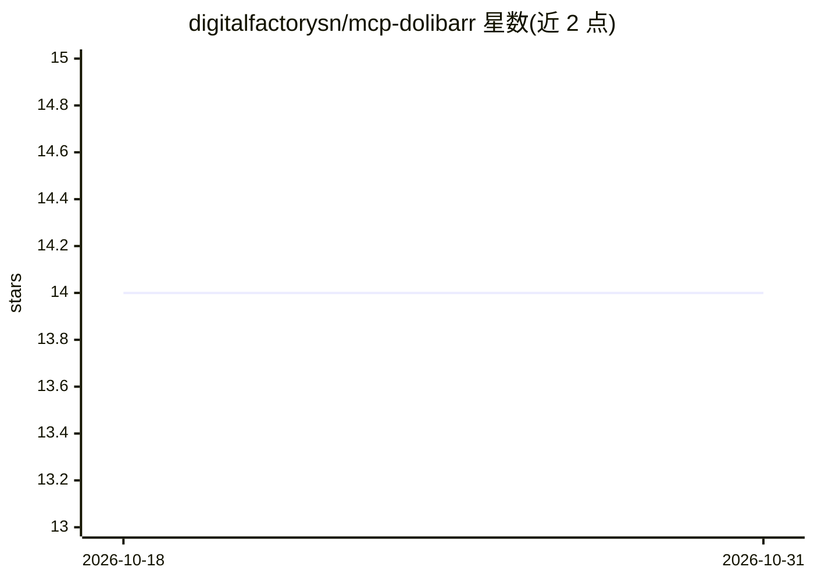

# digitalfactorysn/mcp-dolibarr

⭐ 14 · TypeScript · 推送 2026-08-06 · [GitHub](https://github.com/digitalfactorysn/mcp-dolibarr) · [官网](https://digitalfactory.sn) · 组织维护

**面向 Dolibarr ERP/CRM 的 MCP 服务器，55+ 工具接入 AI 助手**

由 Digital Factory Senegal 开发的 TypeScript MCP 服务器，通过 Dolibarr REST API 让 Claude Desktop、Cursor、Windsurf 等 AI 助手操作 ERP/CRM：第三方管理、发票开具与支付、报价、订单、产品与库存、银行账户与会计分录、CRM 联系人与日程、项目任务、合同及系统配置，共 55+ 工具。要求在 Dolibarr 中启用 REST API 模块并生成 API key，密钥仅在本地与 Dolibarr 实例之间传输。支持 npx 免安装运行、npm 全局安装或源码构建。

## 筛选速览

| 维度 | 判定 | 备注 |
|---|---|---|
| AI 角色 | `ai-ecosystem` | LLM/agent 周边工具 |
| 许可风险 | `permissive` | — |
| 部署形态 | `library` | 以包/库形式分发 |
| 模型依赖 | locked-api |  |
| 硬件要求 | — | 无带数字的原话,不猜 |
| 安装摩擦 | `low` | 无编译、无系统依赖或容器化 |
| 成熟度 | — | 结构信号不足 |

## 能力要点

- 55+ 工具覆盖 Dolibarr 全模块（计费、会计、CRM、库存、合同、系统配置）
- 支持多发票分摊付款记账、贷方通知单与邮件发送发票
- 财务汇总报表：营业额、未结清款项、现金余额
- npx 免安装运行，配置 Claude Desktop / Cursor / Windsurf 连接

## 适用场景

- 让 Claude 等 AI 助手直接查询和操作 Dolibarr 业务数据
- 通过自然语言生成发票、报价与订单
- 用 AI 汇总财务状况与未付款项

## 场景标签

 · 领域:企业软件集成/ERP-CRM

## 证据(README 行号)

> L7: > Un serveur **Model Context Protocol (MCP)** complet pour Dolibarr ERP/CRM. Permets à n'importe quel assistant IA (
> L92: ## 🔌 Connexion avec Claude Desktop

## 星数曲线

2026-10-18 14 → 2026-10-31 14（+0）

---
*卡片 v1 · prompt 1.4 · 生成 2026-10-31 · 置信度 high · 依据 README sha `e9e8010f36f2` · [字段定义](../../DATASET.md)*
