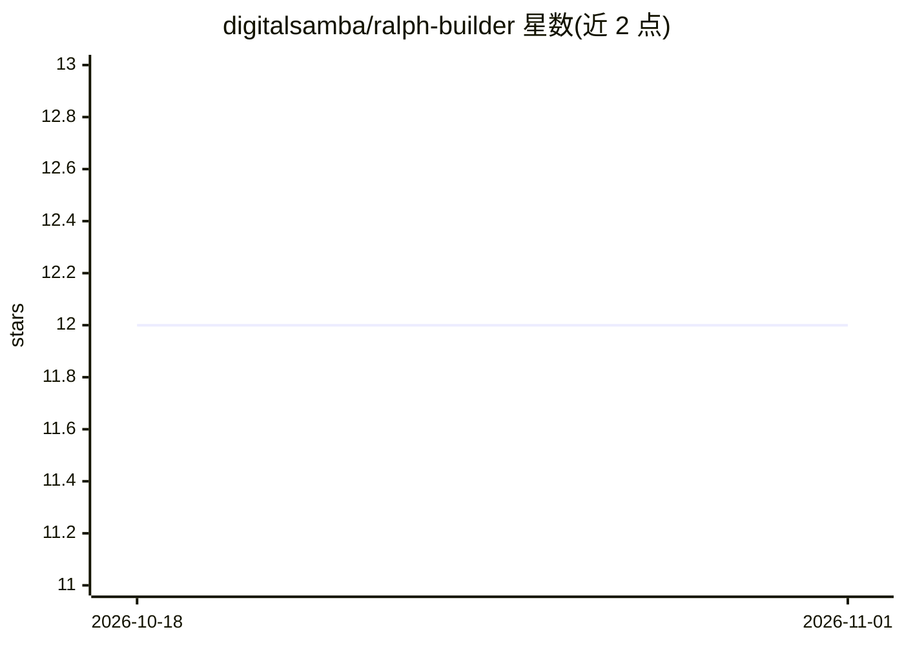

# digitalsamba/ralph-builder

⭐ 12 · Shell · 推送 2026-02-17 · [GitHub](https://github.com/digitalsamba/ralph-builder) · 组织维护

**驱动 Claude Code 自主编码循环的 PRD 规划工具包**

基于 Geoff Huntley 的 Ralph 概念构建的工具包，分两阶段运行：设置阶段由 Claude 以访谈方式收集项目定义、技术栈、外部服务与功能拆解，生成含原子任务（布尔 passes 字段）的 plan.md；执行阶段由 ralph.sh bash 循环反复以新上下文调用 Claude Code，每次迭代完成一个任务并验证提交，直到输出 COMPLETE 或 BLOCKED 信号。面向已安装 Claude Code CLI 的开发者，提供迭代数、模型选择等参数，并自动轮转活动日志以控制上下文窗口大小。

## 筛选速览

| 维度 | 判定 | 备注 |
|---|---|---|
| AI 角色 | `ai-ecosystem` | LLM/agent 周边工具 |
| 许可风险 | `none` | — |
| 部署形态 | `None` |  |
| 模型依赖 | — | README 未给出锁定关系 |
| 硬件要求 | — | 无带数字的原话,不猜 |
| 安装摩擦 | `low` | 无编译、无系统依赖或容器化 |
| 成熟度 | — | 结构信号不足 |

## 能力要点

- 访谈式 PRD 生成，任务带布尔 passes 验证标准
- bash 循环每轮新上下文执行单任务直至完成
- COMPLETE/BLOCKED 退出信号与活动日志轮转机制
- 按技术栈生成 .claude/settings.json 工具权限

## 适用场景

- 让 Claude Code 按规划好的原子任务自主连续编码
- 通过结构化 PRD 把功能想法拆成可验证任务
- 长时间自主运行中监控代理进度并排查卡阻

## 场景标签

`编码 Agent` · 领域:编码与开发

## 证据(README 行号)

> L3: A toolkit for creating solid PRDs and running autonomous Claude Code loops.
> L10: 2. **Execution Phase**: Bash loop runs Claude iteratively with fresh context until complete
> L78: ./ralph-builder/ralph.sh

## 星数曲线

2026-10-18 12 → 2026-11-01 12（+0）

---
*卡片 v1 · prompt 1.4 · 生成 2026-11-01 · 置信度 high · 依据 README sha `865b6e856083` · [字段定义](../../DATASET.md)*
