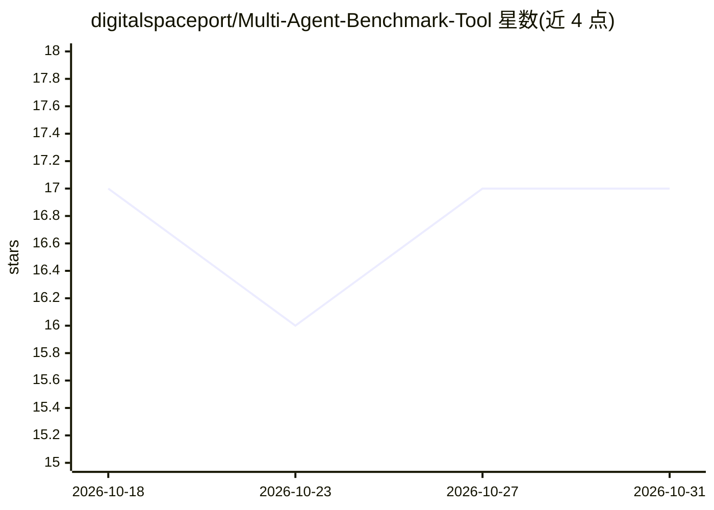

# digitalspaceport/Multi-Agent-Benchmark-Tool

⭐ 17 · Python · MIT · 推送 2026-03-30 · [GitHub](https://github.com/digitalspaceport/Multi-Agent-Benchmark-Tool) · [官网](https://digitalspaceport.com) · 个人维护

**本地推理栈的多 agent 并发负载基准工具：测 TTFT/吞吐/工具调用**

轻量异步 Python 基准工具，模拟多个 Openclaw 或 Hermes 风格的自主 agent 向单一 OpenAI 兼容端点（如 vLLM、llama.cpp）发请求。测量 TTFT、TPOT、p95 延迟、prefill/decode 吞吐与达成 RPS，支持带流式聚合与消息重建的工具调用、工具输出后的后续请求、多模态图像输入，以及带抖动的 pacing 控制与 token 用量回退估算。面向想调优本地推理栈以承载多 agent 的用户。依赖 Python 3.9+ 与 openai SDK，直接运行 mabt.py。注意：'Hermes 风格'仅指负载的提示模式，非与特定框架的兼容声明。

## 筛选速览

| 维度 | 判定 | 备注 |
|---|---|---|
| AI 角色 | `ai-ecosystem` | LLM/agent 周边工具 |
| 许可风险 | `permissive` | MIT |
| 部署形态 | `library` | 以包/库形式分发 |
| 模型依赖 | local-ok | 支持本地模型 |
| 硬件要求 | — | 无带数字的原话,不猜 |
| 安装摩擦 | `low` | 无编译、无系统依赖或容器化 |
| 成熟度 | — | 结构信号不足 |

## 能力要点

- TTFT/TPOT/p95 延迟、prefill 与 decode 吞吐、达成 RPS 等请求级指标
- 模拟工具调用流式重建、工具输出后的 follow-up 请求与多模态图像输入
- 带抖动的 pacing 控制、SDK 级重试与超时，token 用量不可用时回退估算
- 输出控制台摘要与 mabt_benchmark_results.json 结果文件

## 适用场景

- 部署本地多 agent 前评估推理栈的延迟与吞吐
- 调优 vLLM / llama.cpp 等端点以承载并发 agent 负载
- 对比不同 pacing 与并发数下的 TTFT 与 RPS 表现

## 场景标签

`模型评测` · 领域:评测与运维

## 证据(README 行号)

> L3: A lightweight, asynchronous benchmark to emulate multiple autonomous Openclaw or “Hermes-style” agents sending reque
> L107: - "High Quality Agents" is a benchmark-specific label and “high quality” refers to agents that are responsive enou

## 星数曲线

2026-10-18 17 → 2026-10-31 17（+0）

---
*卡片 v1 · prompt 1.4 · 生成 2026-10-29 · 置信度 mid · 依据 README sha `2da4cf90823c` · [字段定义](../../DATASET.md)*
