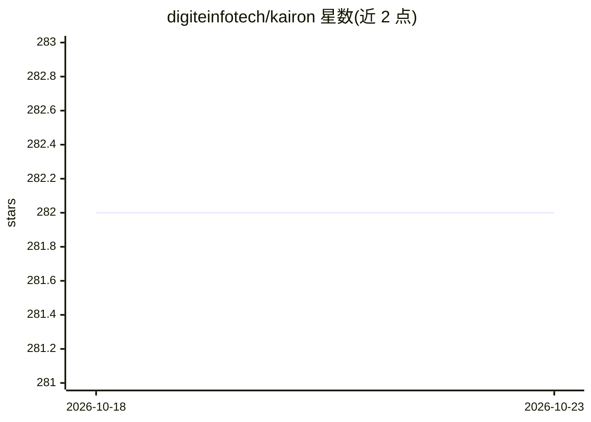

# digiteinfotech/kairon

⭐ 282 · Python · Apache-2.0 · 推送 2026-10-22 · [GitHub](https://github.com/digiteinfotech/kairon) · [官网](https://kairon.com) · 组织维护

**基于 Rasa 的对话助手低代码构建与全生命周期管理平台**

Kairon 是构建在 Rasa 开源框架之上的对话式数字助手平台，面向无编码能力的产品/营销团队与希望自托管的团队：通过 Web 界面完成助手的创建、训练、测试与部署维护。功能包括问题增强与知识图谱生成、遥测监控、聊天客户端设计器、分析模块、实时挣扎分析与全渠道多语言集成。部署仅需 Docker 与 Docker Compose；开发模式要求 Python 3.10 与 MongoDB 4.0+，Windows 下依赖锁无法解析。由 NimbleWork Inc. 维护，采用 Apache 2.0 许可。

## 筛选速览

| 维度 | 判定 | 备注 |
|---|---|---|
| AI 角色 | `ai-ecosystem` | LLM/agent 周边工具 |
| 许可风险 | `permissive` | Apache-2.0 |
| 部署形态 | `self-host` | docker 或自建部署 |
| 模型依赖 | — | README 未给出锁定关系 |
| 硬件要求 | — | 无带数字的原话,不猜 |
| 安装摩擦 | `low` | 无编译、无系统依赖或容器化 |
| 成熟度 | — | 结构信号不足 |

## 能力要点

- 在 Rasa 之上提供无编码 Web 界面，覆盖助手创建到部署监控的全生命周期
- 问题增强与知识图谱自动生成 intents/问题/响应
- 遥测与实时挣扎分析，可在用户受阻时主动介入
- 通过脚本注入将助手部署到网站/SaaS 产品

## 适用场景

- 非技术团队用无编码界面搭建和训练数字助手
- 企业以 Docker Compose 自托管对话助手训练平台
- 将助手嵌入官网并监控用户交互与受阻情况

## 场景标签

`聊天机器人` `知识图谱` · 领域:对话与助手

## 证据(README 行号)

> L9: Kairon is currently a set of tools built on the RASA framework with a helpful UI interface .
> L15: Kairon is open-source. It is a Conversational digital transformation platform: Kairon is a platform that allows com
> L35: Teams and Individuals who want an easy no-coding interface to create, train, test and deploy digital assistants . O

## 星数曲线

2026-10-18 282 → 2026-10-23 282（+0）

---
*卡片 v1 · prompt 1.4 · 生成 2026-10-22 · 置信度 high · 依据 README sha `459ec1ed8c7a` · [字段定义](../../DATASET.md)*
