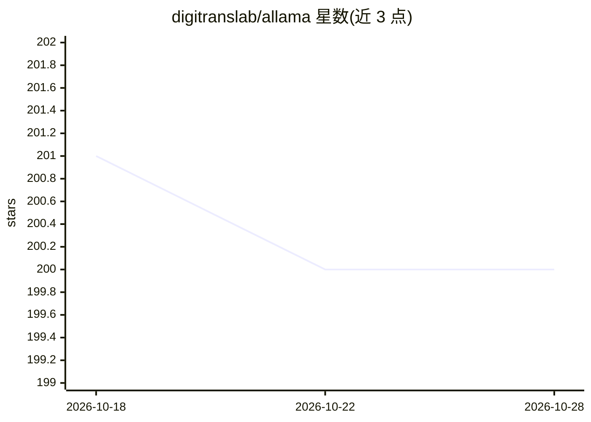

# digitranslab/allama

⭐ 200 · Python · AGPL-3.0 · 推送 2026-02-11 · [GitHub](https://github.com/digitranslab/allama) · 组织维护

**面向 SOC 团队的开源自托管 AI 安全自动化（SOAR）平台**

自托管的 AI 安全自动化平台：提供可视化拖拽工作流构建器、自主 AI Agent、80+ 安全工具集成（SIEM/EDR/身份/工单/云）、案件管理与 WebAssembly 沙箱脚本执行。AI 模型支持 OpenAI、Anthropic、Azure 或经 Ollama 的自托管模型，底层用 Temporal 持久化执行、PydanticAI+LiteLLM 做多模型编排，PostgreSQL 存储。要求 Docker、Python 3.12+、4GB 内存、10GB 磁盘。

## 筛选速览

| 维度 | 判定 | 备注 |
|---|---|---|
| AI 角色 | `ai-enhanced` | 去掉 AI 部分产品仍成立 |
| 许可风险 | `viral` | AGPL-3.0 |
| 部署形态 | `None` |  |
| 模型依赖 | local-ok | 支持本地模型 |
| 硬件要求 | — | 无带数字的原话,不猜 |
| 安装摩擦 | `low` | 无编译、无系统依赖或容器化 |
| 成熟度 | — | 结构信号不足 |

## 能力要点

- 可视化拖拽安全工作流构建器，支持条件/并行/循环
- 80+ 集成：Splunk、Elastic、CrowdStrike、Okta、Jira、AWS 等
- AI Agent 支持 OpenAI/Anthropic/Azure/Ollama 多模型
- WebAssembly 沙箱隔离执行自定义 Python 脚本

## 适用场景

- SOC 团队自动化告警分流、富化与处置
- MSSP 多租户白标部署安全运营服务
- 云环境自托管安全编排，满足数据主权要求

## 场景标签

`网络安全` `工作流自动化` · 领域:效率与自动化

## 证据(README 行号)

> L7:  Automate threat detection and response with AI-powered workflows.
> L31: - **90% faster triage** — AI agents enrich and prioritise alerts automatically

## 星数曲线

2026-10-18 201 → 2026-10-28 200（-1）

---
*卡片 v1 · prompt 1.4 · 生成 2026-10-22 · 置信度 mid · 依据 README sha `84d1710274e9` · [字段定义](../../DATASET.md)*
