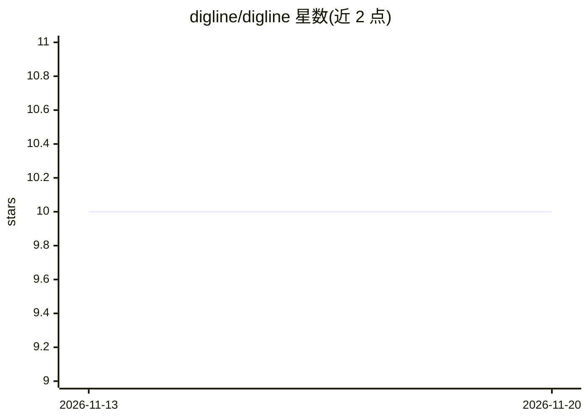

# digline/digline

⭐ 10 · Python · Apache-2.0 · 推送 2026-11-19 · [GitHub](https://github.com/digline/digline) · [官网](https://digline.dev) · 组织维护

**为 LLM 应用在 CI 中做回归测试的 Python CLI 与 pytest 插件**

digline 记录 agent 或应用与模型的收发内容，无需改动代码即可据此提议首个测试套件，并将用户批准的一次运行冻结为参考基线；此后每次运行与基线比较答案、步骤、工具调用顺序与成本，通过退出码给出判定（0 通过、1 变差、2 数字异常）。套件以 Python 或 TOML 表达，提供 pass/fail/error 三态判定、噪声容差声明与成本/延迟预算断言，基线作为仓库内文件接受评审。提供 CLI、pytest 插件与 MCP server，以 Claude Code 插件形式安装。

## 筛选速览

| 维度 | 判定 | 备注 |
|---|---|---|
| AI 角色 | `ai-ecosystem` | LLM/agent 周边工具 |
| 许可风险 | `permissive` | Apache-2.0 |
| 部署形态 | `library` | 以包/库形式分发 |
| 模型依赖 | locked-api |  |
| 硬件要求 | — | 无带数字的原话,不猜 |
| 安装摩擦 | `low` | 无编译、无系统依赖或容器化 |
| 成熟度 | — | 结构信号不足 |

## 能力要点

- 录制收发内容自动提议套件，冻结参考基线并在 CI 中以退出码判定
- pass/fail/error 三态判定与可声明的噪声容差（floor_standard_errors）
- 工具调用轨迹断言（ToolsCalled/ToolCalledWith/Subsequence/Before/Never/MaxSteps）与成本/延迟预算
- MCP server 只测量与解释，不提供 promote 工具，基线晋升需人工签名

## 适用场景

- 在 CI 中拦截让 agent 或 prompt 变差的代码变更
- 为交付给客户的 LLM 功能留存测试与审批记录
- 检测模型别名指向变化导致的输出漂移

## 场景标签

`模型评测` · 领域:评测与运维

## 证据(README 行号)

> L24: digline records what the agent or the prompt sends and receives,
> L55: Most evaluation tools tell you whether an output is below a threshold. digline
> L84: If you use Claude Code, digline also installs as a plugin with an MCP server — see

## 星数曲线

2026-11-13 10 → 2026-11-20 10（+0）

---
*卡片 v1 · prompt 1.4 · 生成 2026-11-19 · 置信度 mid · 依据 README sha `a5f6a61941b0` · [字段定义](../../DATASET.md)*
