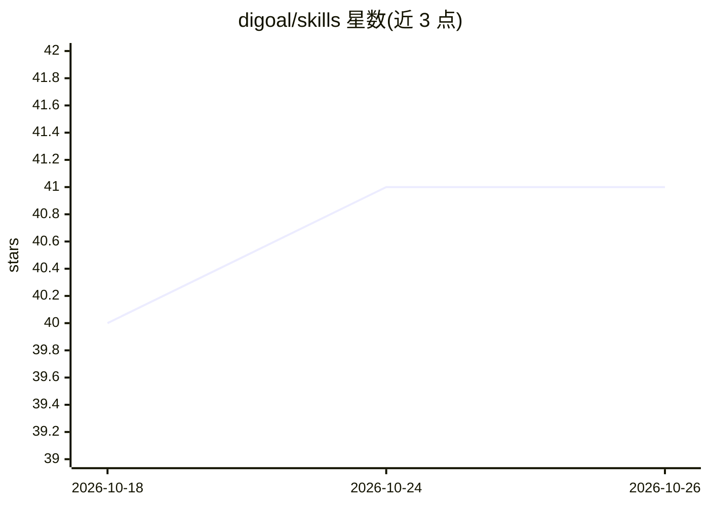

# digoal/skills

⭐ 41 · Python · GPL-2.0 · 推送 2026-10-12 · [GitHub](https://github.com/digoal/skills) · 个人维护 · 中文 README

**个人维护的 Claude/Codex 技能（SKILL）合集：财经、写作、数据库等**

digoal（德哥）维护的 AI agent 技能仓库：以 submodule 方式聚合自研与第三方 SKILL，覆盖财经分析与预测、数据库（PostgreSQL/Kingbase）问答与找 bug、产业与企业分析、写作/播客/视频生成、角色蒸馏（女娲 skill）、带娃解题等类别。技能面向 Claude Code、Codex 等 agent 框架运行，通过 git clone 并拷贝到 ~/.claude/skills 目录安装；部分技能依赖联网抓取、http proxy 与本地克隆的源码目录。

## 筛选速览

| 维度 | 判定 | 备注 |
|---|---|---|
| AI 角色 | `ai-knowledge` | 知识聚合/清单类 |
| 许可风险 | `viral` | GPL-2.0 |
| 部署形态 | `library` | 以包/库形式分发 |
| 模型依赖 | — | README 未给出锁定关系 |
| 硬件要求 | — | 无带数字的原话,不猜 |
| 安装摩擦 | `medium` | 含编译或系统依赖之一 |
| 成熟度 | — | 结构信号不足 |

## 能力要点

- 财经类技能链：日报采集→深度分析→爆款文→小白解读→周展望
- 数据库技能：PostgreSQL 提交区间解读、源码问答、找 bug 并生成上报信息
- 女娲/达尔文 skill 支持角色蒸馏与技能进化
- 输出统一为 markdown 文件保存到项目目录

## 适用场景

- 为 Claude Code / Codex 配置财经分析与写作技能
- 基于 PostgreSQL 源码做问答助手或给社区找 bug
- 将文章转成播客脚本、公众号爆款文或视频播客

## 场景标签

`精选清单` · 领域:学习与行业

## 证据(README 行号)

> L28: ## skill 介绍
> L307: ### PostgreSQL 数据库专用 SKILLs
> L329: `skills_for_claude_web` 目录中的 skill 仅用于 Claude web 版.

## 星数曲线

2026-10-18 40 → 2026-10-26 41（+1）

---
*卡片 v1 · prompt 1.4 · 生成 2026-10-25 · 置信度 mid · 依据 README sha `d8dffc9b960e` · [字段定义](../../DATASET.md)*
