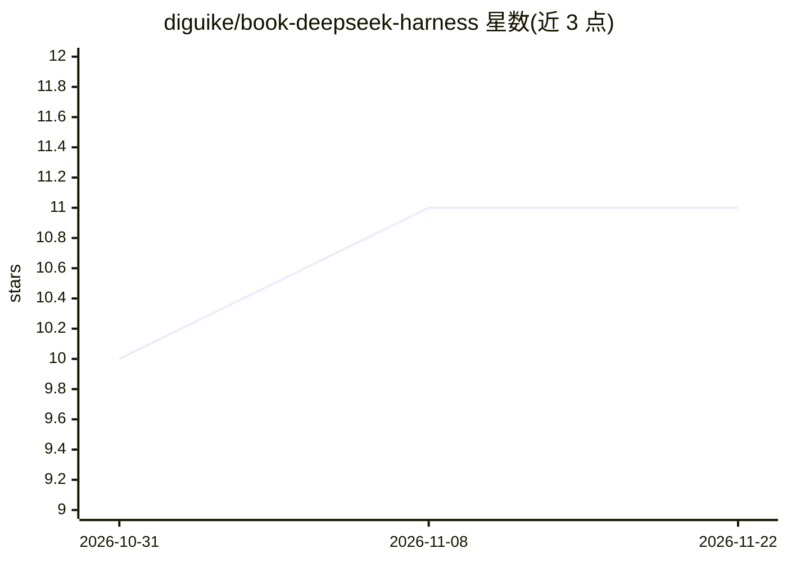

# diguike/book-deepseek-harness

⭐ 11 · TypeScript · NOASSERTION · 推送 2026-08-18 · [GitHub](https://github.com/diguike/book-deepseek-harness) · [官网](https://inferloop.dev) · 个人维护 · 中文 README

**面向工程师的 DeepSeek Harness（dsh）源码精读与插件开发书籍**

一本书及其配套代码仓库，内容为对 DeepSeek 开源 agent harness `dsh` 的源码精读：讲其插件化设计（配置驱动的主循环、模型适配器、会话日志），并用 TypeScript 手写一个约 2,655 行的 mini-dsh 迷你实现供读者逐章练习。配套真实插件案例、各章实测产物与采集命令。读者定位为搭公司 agent 平台的工程师、想扩展 Claude Code/Codex 的中高级工程师及转 AI 的后端工程师。书中数据来自 DeepSeek 官方端点实测，源码基准为 0.1.0-rc 阶段版本，勘误以 ERRATA.md 维护。

## 筛选速览

| 维度 | 判定 | 备注 |
|---|---|---|
| AI 角色 | `ai-knowledge` | 知识聚合/清单类 |
| 许可风险 | `none` | NOASSERTION |
| 部署形态 | `None` |  |
| 模型依赖 | — | README 未给出锁定关系 |
| 硬件要求 | — | 无带数字的原话,不猜 |
| 安装摩擦 | `low` | 无编译、无系统依赖或容器化 |
| 成熟度 | `idea` | |

## 能力要点

- mini-dsh 迷你实现：2,655 行 TypeScript、65 个测试，零依赖、Node 22.6+ 可运行
- 各章提供 start/done 两个 git tag，任意一章可独立 checkout 开工
- 每个数字附产生它的命令（附录 A），断言落到代码或门禁脚本
- 正文 CC BY-NC-SA 4.0、代码 MIT 双许可分发

## 适用场景

- 为公司内部 agent 平台做架构选型与设计文档参考
- 跟随 mini-dsh 逐章练习理解 agent harness 的插件化设计
- 了解 dsh 与 Claude Code / Codex 等工具的抽象层差异

## 场景标签

`教程课程` · 领域:学习与行业

## 证据(README 行号)

> L3: **DeepSeek Harness 源码精读、Mini 实现与插件开发实战**
> L5: 这本书讲 DeepSeek 官方开源的 agent harness `dsh` 本身是怎么设计的——不是怎么用它写代码，是它凭什么能让主循环、模型适配器、会话日志都变成配置里的一行。
> L41: ## 目录

## 星数曲线

2026-10-31 10 → 2026-11-22 11（+1）

---
*卡片 v1 · prompt 1.4 · 生成 2026-11-18 · 置信度 high · 依据 README sha `762662c11cb7` · [字段定义](../../DATASET.md)*
