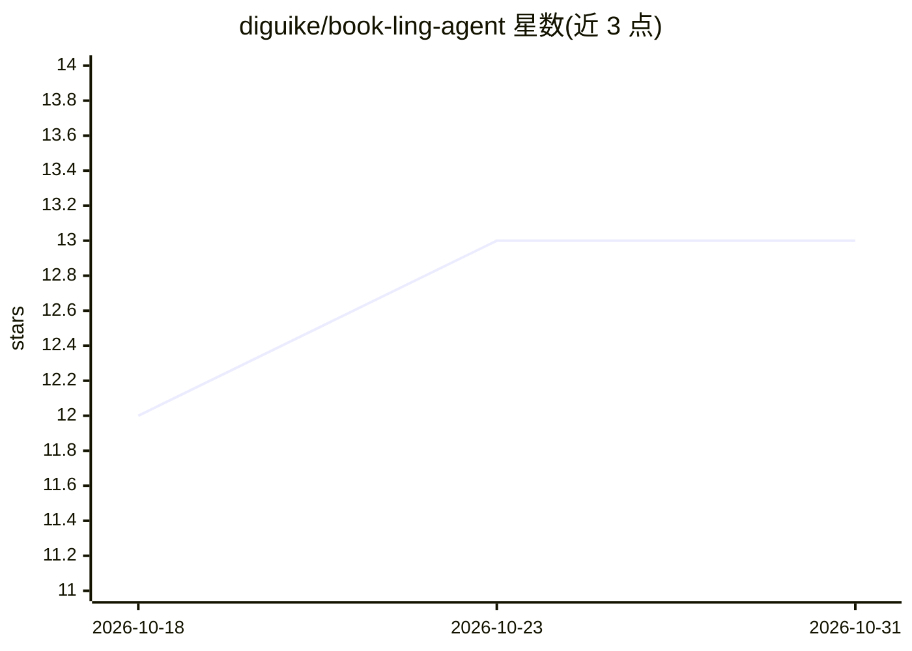

# diguike/book-ling-agent

⭐ 13 · TypeScript · MIT · 推送 2026-08-04 · [GitHub](https://github.com/diguike/book-ling-agent) · [官网](https://inferloop.dev/ling-agent) · 个人维护 · 中文 README

**教你从零实现 AI 编程助手的中文书及配套代码仓库**

全书 11 章 + 终章 + 4 附录，以从零构建 TypeScript 编程助手 Ling 为贯穿项目：从 50 行的 Agentic Loop 起步，逐章扩展 Provider 抽象、工具系统、上下文工程、权限沙箱、流式交互、会话记忆、Hook、MCP 协议与多 Agent 协作。核心代码约 1800 行，含 8 个内置工具，支持火山引擎/阿里云百炼/Claude/OpenAI 四家 API，可跑交互式 CLI、非交互 CI/CD 与 Print 模式；code/ch10 为完整版可直接使用。

## 筛选速览

| 维度 | 判定 | 备注 |
|---|---|---|
| AI 角色 | `ai-knowledge` | 知识聚合/清单类 |
| 许可风险 | `permissive` | MIT |
| 部署形态 | `None` |  |
| 模型依赖 | locked-api |  |
| 硬件要求 | — | 无带数字的原话,不猜 |
| 安装摩擦 | `low` | 无编译、无系统依赖或容器化 |
| 成熟度 | — | 结构信号不足 |

## 能力要点

- 全书配套分章代码，每章递进构建 Agent
- Ling 支持 MCP 协议与 8 个内置工具，核心约 1800 行 TypeScript
- 支持火山引擎（豆包）/阿里云百炼/Claude/OpenAI 四家 API
- code/ch10 为完整版，可直接当编程助手使用

## 适用场景

- 跟着书一步步写出自己的 AI 编程助手
- 学习 MCP、上下文工程、权限沙箱等 Agent 工程概念
- 直接使用 ch10 完整版 Ling 辅助日常编码

## 场景标签

`教程课程` `编码 Agent` `Agent 框架` · 领域:Agent 开发

## 证据(README 行号)

> L8: > 配套代码仓库 · 全书 11 章 + 终章 + 4 附录
> L12: 一个从零构建的 AI 编程助手，全书贯穿项目。读完本书，你将拥有一个能理解项目、能改代码、能接外部工具、能跑在 CI 里的 Agent。
> L88: **跟书读**：按 ch01 → ch10 顺序，每章在前一章基础上递进。先读书稿理解原理，再看代码动手跑。

## 星数曲线

2026-10-18 12 → 2026-10-31 13（+1）

---
*卡片 v1 · prompt 1.4 · 生成 2026-10-31 · 置信度 high · 依据 README sha `15b91e5d2a70` · [字段定义](../../DATASET.md)*
