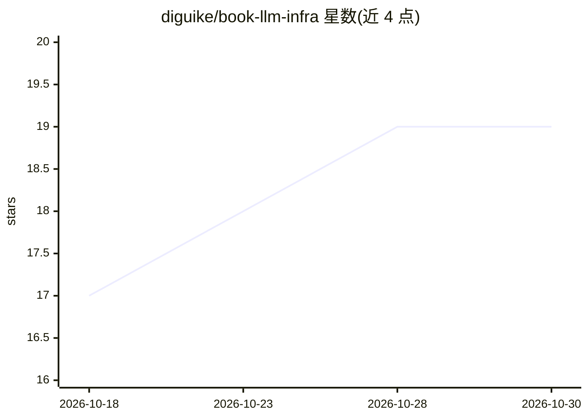

# diguike/book-llm-infra

⭐ 19 · NOASSERTION · 推送 2026-10-27 · [GitHub](https://github.com/diguike/book-llm-infra) · [官网](https://inferloop.dev/llm-infra) · 个人维护 · 中文 README

**面向应用层工程师的 LLM 基础设施实战书（含代码示例）**

一本中文在线书籍《LLM Infra 从入门到实践》，面向前端/全栈/Agent 开发者，系统讲解 LLM 基础设施知识。每章配套可运行代码示例，部署示例基于阿里云/腾讯云以确保国内可用。环境要求 Python 3.10+、PyTorch 2.0+，部分章节需要 GPU（最低 RTX 3090 或对应云实例）。通过 GitHub 克隆获取，在线阅读托管于飞书 Wiki 与 inferloop.dev，采用 CC BY-NC-SA 4.0 许可。

## 筛选速览

| 维度 | 判定 | 备注 |
|---|---|---|
| AI 角色 | `ai-knowledge` | 知识聚合/清单类 |
| 许可风险 | `none` | NOASSERTION |
| 部署形态 | `None` |  |
| 模型依赖 | — | README 未给出锁定关系 |
| 硬件要求 | — | 无带数字的原话,不猜 |
| 安装摩擦 | `low` | 无编译、无系统依赖或容器化 |
| 成熟度 | — | 结构信号不足 |

## 能力要点

- 每章配套可运行代码示例
- 部署示例基于阿里云/腾讯云
- 部分章节标注 GPU 硬件要求（最低 RTX 3090）

## 适用场景

- 应用层工程师系统学习 LLM Infra 知识
- Agent 开发者了解推理部署底层机制
- 国内云环境部署 LLM 推理服务的参考

## 场景标签

`推理引擎` `教程课程` · 领域:学习与行业

## 证据(README 行号)

> L6: > 一本写给 Agent 开发者的 LLM 底层技术指南
> L8: 面向应用层工程师（前端/全栈/Agent 开发者），系统化学习 LLM 基础设施知识。

## 星数曲线

2026-10-18 17 → 2026-10-30 19（+2）

---
*卡片 v1 · prompt 1.4 · 生成 2026-10-28 · 置信度 high · 依据 README sha `9bf7b608e929` · [字段定义](../../DATASET.md)*
