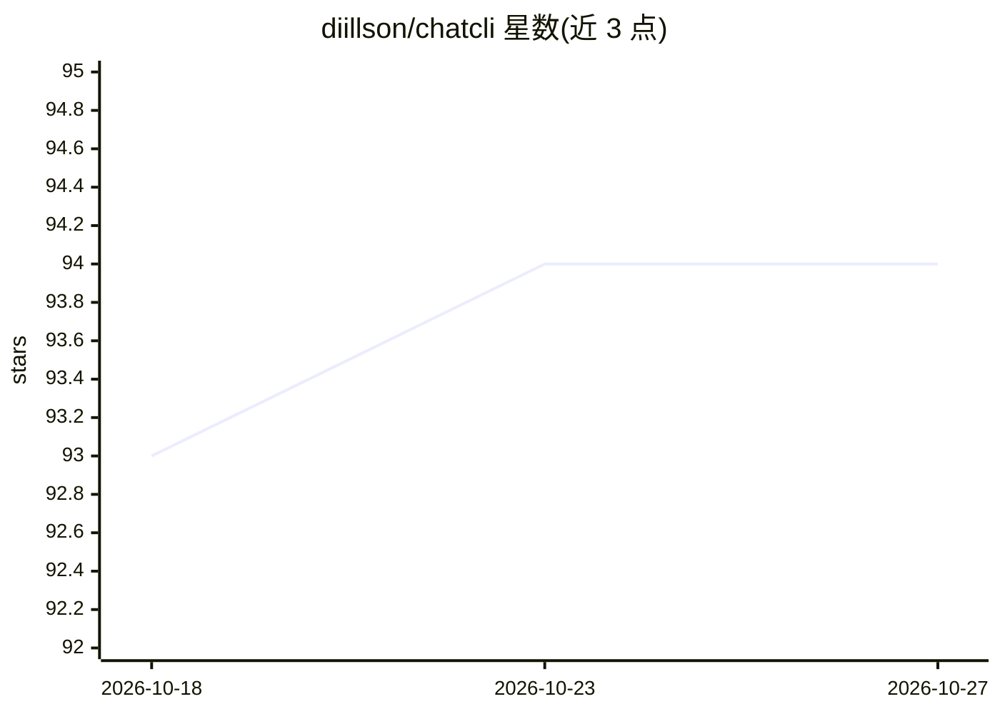

# diillson/chatcli

⭐ 94 · Go · Apache-2.0 · 推送 2026-10-26 · [GitHub](https://github.com/diillson/chatcli) · [官网](https://chatcli.edilsonfreitas.com/) · 个人维护

**终端 LLM 客户端：单二进制接入 14 家模型，带编码 agent 与质量验证**

用 Go 编写的命令行 AI 应用，单一二进制覆盖终端、浏览器 UI、编辑器（ACP）、MCP 客户端、聊天网关（Telegram/Slack/Discord/WhatsApp）、gRPC 服务与 Kubernetes operator。内置 14 个 LLM 提供商统一接口，支持会话中切换模型与故障转移；/coder 提供 ReAct 循环加 50 个内建工具、策略门控与检查点；质量机制含 Reflexion、RAG+HyDE、Chain-of-Verification、Self-Refine 与带交叉评审的 Mixture-of-Agents；另有 APM 式实时仪表盘、长期记忆与可逆压缩。Apache-2.0 许可。

## 筛选速览

| 维度 | 判定 | 备注 |
|---|---|---|
| AI 角色 | `ai-ecosystem` | LLM/agent 周边工具 |
| 许可风险 | `permissive` | Apache-2.0 |
| 部署形态 | `library` | 以包/库形式分发 |
| 模型依赖 | local-ok | 支持本地模型 |
| 硬件要求 | — | 无带数字的原话,不猜 |
| 安装摩擦 | `low` | 无编译、无系统依赖或容器化 |
| 成熟度 | — | 结构信号不足 |

## 能力要点

- 14 个内置 LLM 提供商统一接口，含回退链与提示缓存
- /coder agent：50 个内建工具、allow/ask/deny 策略、影子仓库检查点
- 七种质量模式（Reflexion、RAG+HyDE、Chain-of-Verification、Self-Refine 等）与 MoA 交叉评审
- 多表面共享会话/记忆/工具：终端、浏览器、编辑器 ACP、MCP、聊天网关、gRPC、Kubernetes

## 适用场景

- 在终端里跨多家模型对话，随时切换提供商
- 让 /coder agent 在受控策略下读写、运行、测试代码
- 把同一 agent 接入 Slack/Telegram 等聊天渠道
- 在 Kubernetes 上以 operator 方式做工作负载监控与修复提案

## 场景标签

`AI 助手` `编码 Agent` `RAG` `Agent 记忆` · 领域:Agent 开发

## 证据(README 行号)

> L10:  14 LLM providers · an autonomous coder agent · a seven-pattern quality harness
> L138: 14 built-in providers behind one interface, with a fallback chain, cross-provider reasoning control (`/thinking`) 

## 星数曲线

2026-10-18 93 → 2026-10-27 94（+1）

---
*卡片 v1 · prompt 1.4 · 生成 2026-10-23 · 置信度 high · 依据 README sha `cf843ea66f0e` · [字段定义](../../DATASET.md)*
