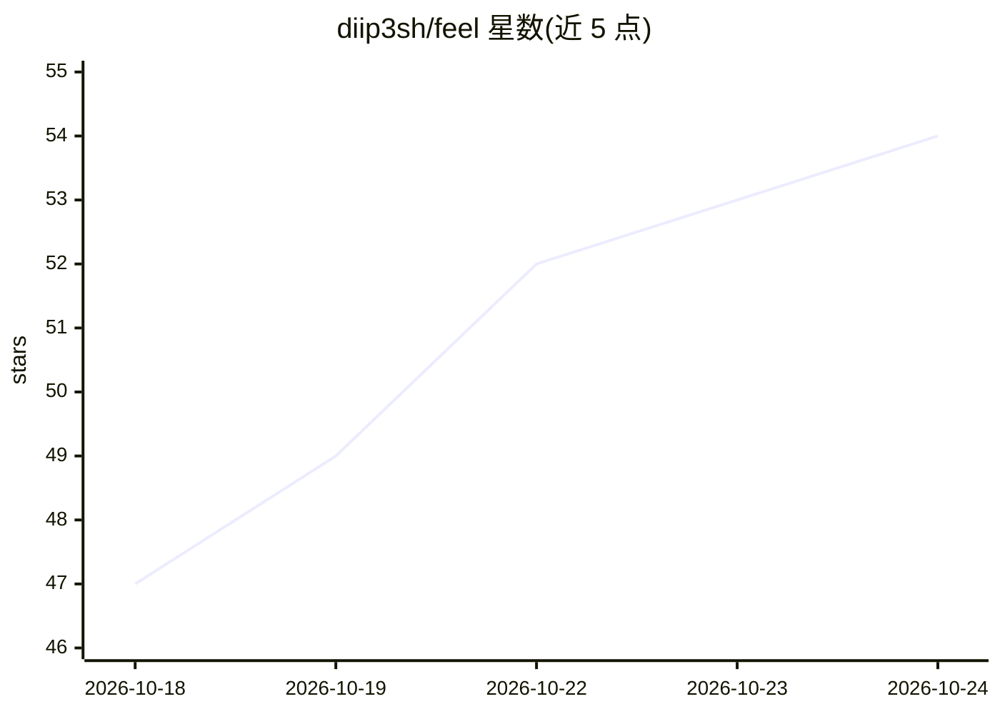

# diip3sh/feel

⭐ 55 · JavaScript · MIT · 推送 2026-10-13 · [GitHub](https://github.com/diip3sh/feel) · [官网](https://diip3sh.github.io/feel) · 个人维护

**给 Claude Code 的物理动效技能：描述手感生成弹簧组件**

一个面向 Claude Code 的 skill（SKILL.md 格式），用自然语言描述交互手感（如"沉重的开关""磁吸抽屉"），生成由质量、刚度、阻尼与力场驱动的交互组件，附带测试 rig 绘制位置/速度/力场并叠加模型预测。强制约束所有动效来自物理模型、禁用手调时长与缓动曲线，提供 audit 脚本扫描违规代码并校验求解器精度；可导出到 Framer Motion、react-spring、SwiftUI、Compose 或 CSS linear()。通过 npx skills 或 git clone 安装，也可直接用其 Feel 运行时 API 编程调用。

## 筛选速览

| 维度 | 判定 | 备注 |
|---|---|---|
| AI 角色 | `ai-ecosystem` | LLM/agent 周边工具 |
| 许可风险 | `permissive` | MIT |
| 部署形态 | `library` | 以包/库形式分发 |
| 模型依赖 | locked-api |  |
| 硬件要求 | — | 无带数字的原话,不猜 |
| 安装摩擦 | `low` | 无编译、无系统依赖或容器化 |
| 成熟度 | — | 结构信号不足 |

## 能力要点

- 质量/刚度/阻尼/力场驱动的交互组件生成
- 测试 rig 绘制轨迹并叠加模型预测，可烘焙 CSS keyframes
- audit 脚本禁用手调时长与缓动曲线并校验求解器
- 同一弹簧模型可导出到 Framer Motion/SwiftUI/Compose/CSS linear()

## 适用场景

- 让 Claude Code 按描述的物理手感生成 UI 交互组件
- 在 React 等前端项目中用 Feel 运行时实现弹簧交互
- 审计代码中是否存在手调时长或缓动曲线

## 场景标签

`代码生成` `提示工程` · 领域:Agent 开发

## 证据(README 行号)

> L3: **Interactions built on physics. No hand-picked durations.** A skill for Claude Code, plus the runtime and test rig 
> L38: npx skills add diip3sh/feel

## 星数曲线

2026-10-18 47 → 2026-10-24 54（+7）

---
*卡片 v1 · prompt 1.4 · 生成 2026-10-24 · 置信度 high · 依据 README sha `78c9405a1151` · [字段定义](../../DATASET.md)*
