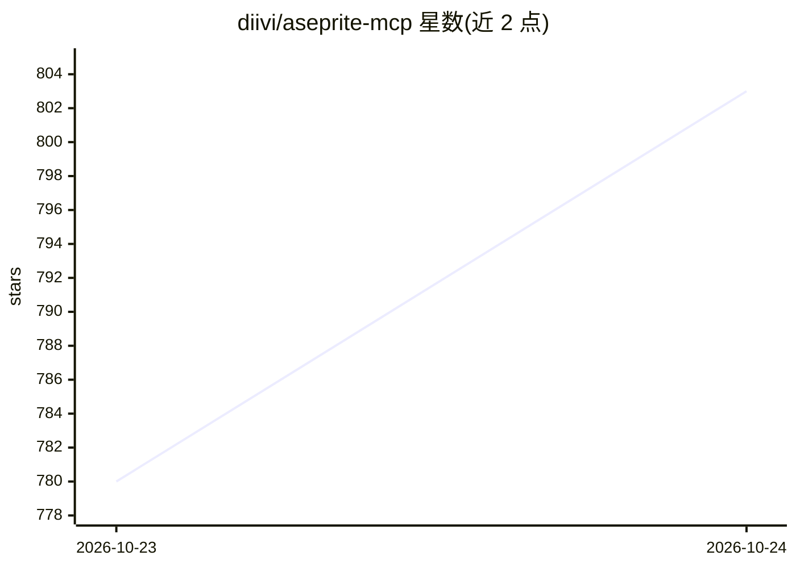

# diivi/aseprite-mcp

⭐ 803 · Python · MIT · 推送 2026-10-21 · [GitHub](https://github.com/diivi/aseprite-mcp) · 个人维护

**让 AI 助手通过 MCP 操控 Aseprite 绘制像素画的服务器**

Python 实现的 MCP 服务器，通过 Aseprite API 向 AI 助手暴露 123 个工具，分 18 类：画布、绘图、文本、图层、选区、效果、动画、调色板、变换、切片、瓦片图、导入导出、检查、视觉反馈、质量校验、场景、预览与 Lua 脚本逃生舱。工具集面向 LLM 绘制像素画设计：含色相偏移渐变、有序抖动、轮廓线、复古调色板预设、洋葱皮渲染、帧差分与 lint 检查。文本绘制在服务器端光栅化（Aseprite Lua API 无文本功能），支持位图字体与 TrueType。面向希望 AI 生成/编辑像素美术与精灵动画的开发者与美术创作者。

## 筛选速览

| 维度 | 判定 | 备注 |
|---|---|---|
| AI 角色 | `ai-ecosystem` | LLM/agent 周边工具 |
| 许可风险 | `permissive` | MIT |
| 部署形态 | `self-host` | docker 或自建部署 |
| 模型依赖 | — | README 未给出锁定关系 |
| 硬件要求 | — | 无带数字的原话,不猜 |
| 安装摩擦 | `low` | 无编译、无系统依赖或容器化 |
| 成熟度 | — | 结构信号不足 |

## 能力要点

- 123 个工具覆盖 18 类 Aseprite 操作
- 面向 LLM 的视觉反馈工具（精灵预览、洋葱皮、帧差分、lint）
- 服务器端文本光栅化，支持位图字体与 TrueType
- 原始 Lua 脚本逃生舱覆盖未封装功能

## 适用场景

- 让 Claude 等 AI 助手生成并迭代像素美术与精灵动画
- 通过对话进行调色板管理、复古预设量化与抖动上色
- AI 驱动的游戏素材制作与帧动画编辑

## 场景标签

`图像生成` · 领域:内容生成

## 证据(README 行号)

> L3: A Python MCP server that gives AI assistants full control over Aseprite for creating pixel art and animated sprites.
> L5: **123 tools across 18 categories** — canvas, drawing, layers, animation, palettes, effects, slices, tilemaps, export

## 星数曲线

2026-10-23 780 → 2026-10-24 803（+23）

---
*卡片 v1 · prompt 1.4 · 生成 2026-10-22 · 置信度 high · 依据 README sha `76a38494777b` · [字段定义](../../DATASET.md)*
