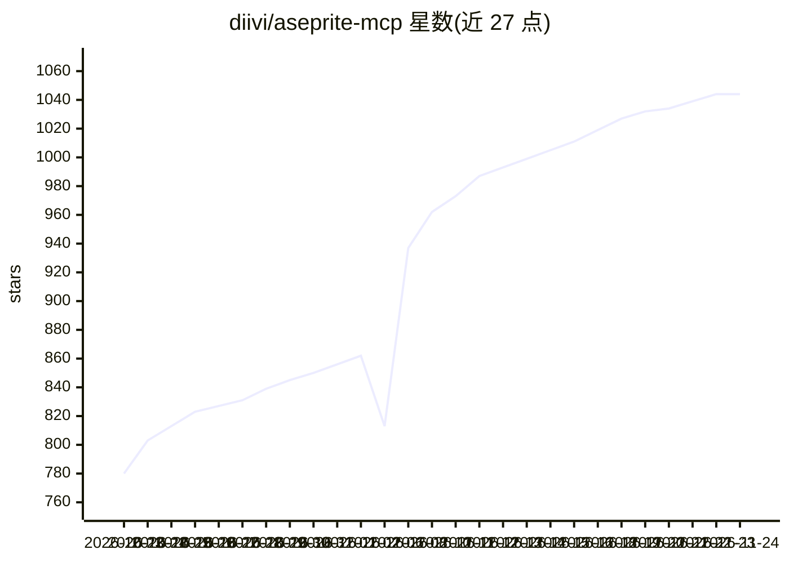

# diivi/aseprite-mcp

⭐ 1,048 · Python · MIT · 推送 2026-11-03 · [GitHub](https://github.com/diivi/aseprite-mcp) · 个人维护

**让 AI 助手通过 MCP 控制 Aseprite 绘制像素画的服务器**

基于 Python 的 MCP 服务器，提供 123 个工具、分 18 类，让接入 MCP 的 AI 助手控制 Aseprite 进行像素画与动画 sprite 创作。工具覆盖画布/图层/动画/调色板/瓦片图/导出等，并针对 LLM 设计了色阶着色、有序抖动、洋葱皮渲染、帧 diff、lint 检查等高级能力；文本绘制因 Aseprite Lua API 缺失而在服务器侧栅格化，支持位图字体与 TrueType 字体两种后端。README 以 Claude 模型的生成示例展示效果。运行需本机安装 Aseprite。

## 筛选速览

| 维度 | 判定 | 备注 |
|---|---|---|
| AI 角色 | `ai-ecosystem` | LLM/agent 周边工具 |
| 许可风险 | `permissive` | MIT |
| 部署形态 | `self-host` | docker 或自建部署 |
| 模型依赖 | — | README 未给出锁定关系 |
| 硬件要求 | — | 无带数字的原话,不猜 |
| 安装摩擦 | `low` | 无编译、无系统依赖或容器化 |
| 成熟度 | — | 结构信号不足 |

## 能力要点

- 123 个工具分 18 类，含原始 Lua escape hatch
- 面向 LLM 的像素画工具：色阶+色相偏移、Bayer 4×4 抖动、复古调色板预设与量化
- 服务器侧栅格化文本绘制，支持位图 sprite-sheet 字体与 TrueType 字体
- 视觉反馈类工具：模型可见的预览、洋葱皮渲染、帧 diff 与 lint 检查

## 适用场景

- 用 Claude 等 MCP 客户端生成静态像素画与循环动画
- 为游戏开发批量绘制与编辑 sprite、tilemap
- 让 AI 复刻/重绘已有 sprite 并做对比评审

## 场景标签

`图像生成` · 领域:内容生成

## 证据(README 行号)

> L3: A Python MCP server that gives AI assistants full control over Aseprite for creating pixel art and animated sprites.
> L5: **123 tools across 18 categories** — canvas, drawing, layers, animation, palettes, effects, slices, tilemaps, export

## 星数曲线

2026-10-23 780 → 2026-11-24 1,044（+264）

---
*卡片 v1 · prompt 1.4 · 生成 2026-11-24 · 置信度 high · 依据 README sha `ddd641d875d9` · [字段定义](../../DATASET.md)*
