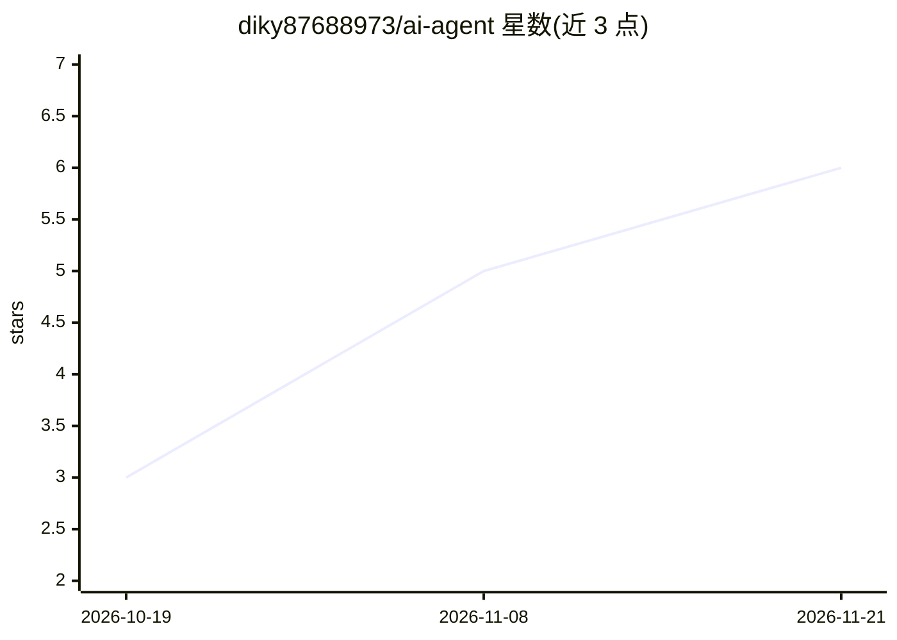

# diky87688973/ai-agent

⭐ 6 · Python · MIT · 推送 2026-11-14 · [GitHub](https://github.com/diky87688973/ai-agent) · 个人维护 · 中文 README

**本地运行的插件化 AI Agent 桌面/Web/终端工作台**

以模块链内核加插件系统组成的可扩展 AI Agent，本机运行或作为服务运行。提供桌面 GUI、Web UI、交互终端与无头执行四个入口，共享会话、工具与写入门禁；插件可注入工具、上下文、模型目录、HTTP 端点与 UI 资产。写入采用预览→审核→提交→重读四步流程并在编辑前自动备份，删除进入回收目录。支持子 Agent 批量协作、后台任务并发限制、定时唤醒与按事件坐标恢复的 SSE 流。提供 Releases 下载的 Windows 整合包，源码方式需 Python 3.10+ 与 WebView2。

## 筛选速览

| 维度 | 判定 | 备注 |
|---|---|---|
| AI 角色 | `ai-native` | 本体是模型或模型工具 |
| 许可风险 | `permissive` | MIT |
| 部署形态 | `desktop` | 安装包/桌面程序 |
| 模型依赖 | — | README 未给出锁定关系 |
| 硬件要求 | — | 无带数字的原话,不猜 |
| 安装摩擦 | `low` | 无编译、无系统依赖或容器化 |
| 成熟度 | — | 结构信号不足 |

## 能力要点

- 四个入口共享同一内核：桌面 GUI、Web UI、agent-cli、agent-headless
- 四步写入门禁（预览→审核→提交→重读）与自动备份回滚
- 插件架构：启动槽可被替换，无需改动内核即可扩展
- 本地 HTTP/SSE 服务与登录鉴权、CSRF、TLS 等访问控制

## 适用场景

- 在本地通过对话让 Agent 执行带审核的文件写入
- 用 agent-headless 把 Agent 接入工单、CI 与脚本流程
- 通过插件扩展工具、知识与模型目录
- 用子 Agent 做多角色并行协作任务

## 场景标签

`AI 助手` `Agent 框架` `多智能体` · 领域:Agent 开发

## 证据(README 行号)

> L5:  An extensible, composable AI Agent foundation
> L39: - **Plugin extensions** — tools, executors, context, prompts, gates, model catalogs, HTTP endpoints, and UI assets 
> L42: - **Multi-agent collaboration** — subagents are created in batches with independent sessions and role-specific tool

## 星数曲线

2026-10-19 3 → 2026-11-21 6（+3）

---
*卡片 v1 · prompt 1.4 · 生成 2026-11-21 · 置信度 mid · 依据 README sha `39db3b677545` · [字段定义](../../DATASET.md)*
