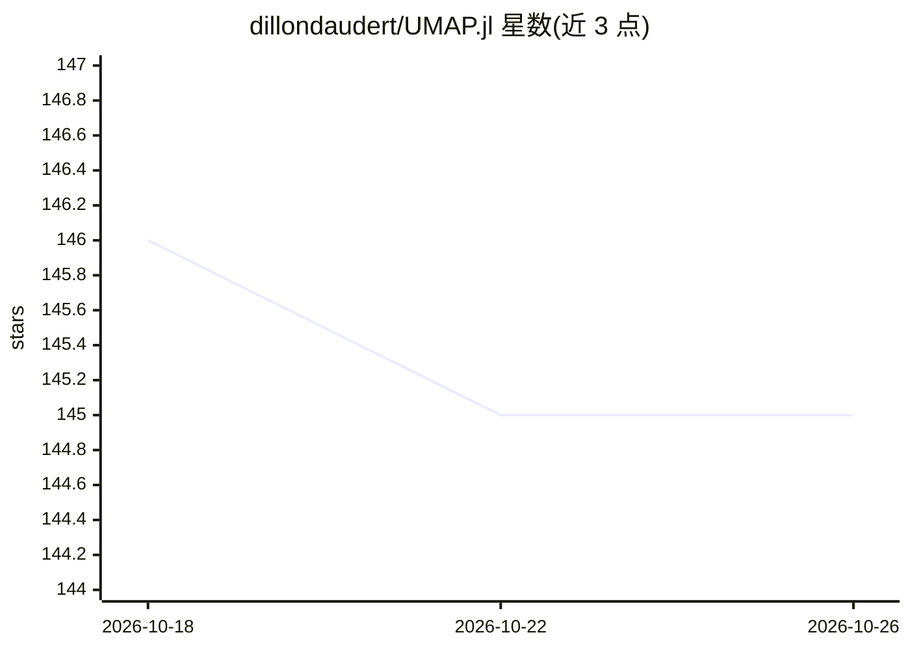

# dillondaudert/UMAP.jl

⭐ 145 · Julia · MIT · 推送 2026-08-19 · [GitHub](https://github.com/dillondaudert/UMAP.jl) · 个人维护

**UMAP 降维算法的纯 Julia 实现**

用纯 Julia 实现的 UMAP（Uniform Manifold Approximation and Projection）降维算法库，供需要降维与可视化的 Julia 开发者使用。提供 UMAP.fit 函数对矩阵或点向量数据生成低维嵌入，支持 n_neighbors、metric（含 Distances.jl 的 SemiMetric 子类型与用户自定义类型）、min_dist 等参数，支持传入预计算距离矩阵（metric=:precomputed），并可通过 UMAP.transform 将新数据映射到同一嵌入空间。文档含 MNIST 等示例。

## 筛选速览

| 维度 | 判定 | 备注 |
|---|---|---|
| AI 角色 | `ai-ecosystem` | LLM/agent 周边工具 |
| 许可风险 | `permissive` | MIT |
| 部署形态 | `None` |  |
| 模型依赖 | — | README 未给出锁定关系 |
| 硬件要求 | — | 无带数字的原话,不猜 |
| 安装摩擦 | `low` | 无编译、无系统依赖或容器化 |
| 成熟度 | — | 结构信号不足 |

## 能力要点

- UMAP.fit 生成低维嵌入，返回 UMAPResult 结构
- 支持任意 SemiMetric 距离（含用户自定义）与预计算距离矩阵
- UMAP.transform 将新数据变换到已有嵌入空间
- 纯 Julia 实现，无 Python 依赖

## 适用场景

- 高维数据的降维与可视化
- 对已有嵌入追加新数据点而不重算
- 使用自定义或预计算距离度量的流形学习

## 场景标签

 · 领域:机器学习/降维可视化

## 证据(README 行号)

> L6: A pure Julia implementation of the Uniform Manifold Approximation and Projection dimension reduction
> L14: result = UMAP.fit(data, n_components; n_neighbors, metric, ...) -> UMAP.UMAPResult

## 星数曲线

2026-10-18 146 → 2026-10-26 145（-1）

---
*卡片 v1 · prompt 1.4 · 生成 2026-10-22 · 置信度 mid · 依据 README sha `998dd46168f3` · [字段定义](../../DATASET.md)*
