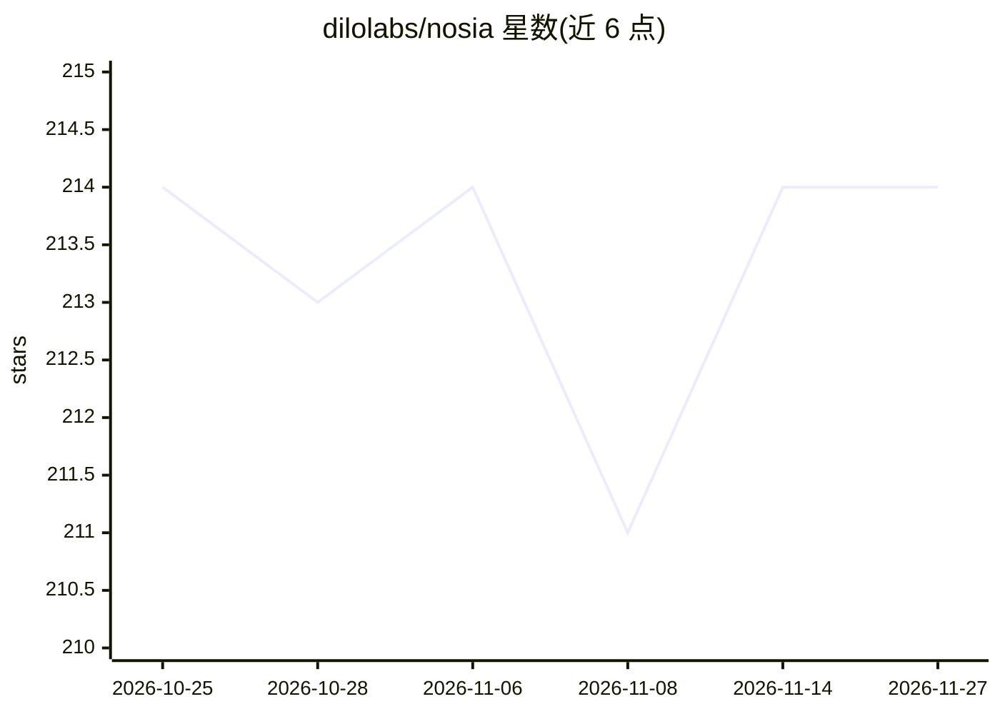

# dilolabs/nosia

⭐ 214 · Ruby · MIT · 推送 2026-11-23 · [GitHub](https://github.com/dilolabs/nosia) · [官网](https://hub.docker.com/r/dilolabs/nosia) · 个人维护

**自托管的私有化 RAG + MCP 平台，用自有数据运行 AI 对话**

Nosia 是一个自托管平台，用于在自有数据上运行 AI 模型：支持上传 PDF、文本、网页与问答对，通过 pgvector 做向量语义检索，开启 AUGMENTED_CONTEXT 后进行检索增强生成；同时集成 Model Context Protocol（MCP），可将日历、文件存储、聊天等外部工具接入对话。提供 OpenAI 兼容 API、多格式文档解析、SSE 流式输出与基于账户的多租户隔离。默认经由 Docker Model Runner 的 llama.cpp 端点调用本地模型，支持替换 Docker Hub AI 上的多个开源模型。

## 筛选速览

| 维度 | 判定 | 备注 |
|---|---|---|
| AI 角色 | `ai-native` | 本体是模型或模型工具 |
| 许可风险 | `permissive` | MIT |
| 部署形态 | `self-host` | docker 或自建部署 |
| 模型依赖 | — | README 未给出锁定关系 |
| 硬件要求 | — | 无带数字的原话,不猜 |
| 安装摩擦 | `low` | 无编译、无系统依赖或容器化 |
| 成熟度 | — | 结构信号不足 |

## 能力要点

- OpenAI 兼容 API，可直接对接现有 OpenAI 客户端
- 基于 pgvector 的向量语义检索与可开关的 RAG 流程
- MCP 集成：目录服务器、OAuth 自定义服务器与 STDIO 本地进程
- 一键安装脚本自动安装 Docker 并生成 .env 配置

## 适用场景

- 在私有基础设施上用自己的文档搭建 AI 问答
- 通过 MCP 让模型访问日历、文件存储等外部工具
- 为现有 OpenAI 客户端应用提供本地模型后端

## 场景标签

`RAG` `文档解析` `文档问答` · 领域:知识与检索

## 证据(README 行号)

> L3: **Self-hosted AI RAG + MCP Platform**
> L5: Nosia is a platform that allows you to run AI models on your own data with complete privacy and control. Beyond trad
> L16: - **🎯 Semantic Search** - Vector similarity search with pgvector

## 星数曲线

2026-10-25 214 → 2026-11-27 214（+0）

---
*卡片 v1 · prompt 1.4 · 生成 2026-11-25 · 置信度 high · 依据 README sha `b6e82b506c65` · [字段定义](../../DATASET.md)*
