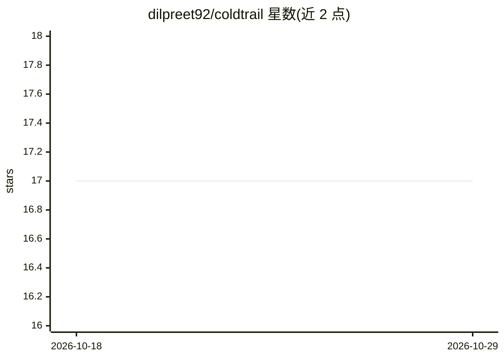

# dilpreet92/coldtrail

⭐ 17 · Rust · MIT · 推送 2026-10-07 · [GitHub](https://github.com/dilpreet92/coldtrail) · [官网](https://trycanonical.ai) · 个人维护

**单人创始人的本地冷启动外联工具：发现公司、起草并代发邮件**

面向单人创始人与一人销售团队的 Rust 单二进制冷外联工具，运行后在浏览器打开本地应用。流程为发现→富化→起草→发送：经 Canonical 按自然语言 ICP 检索并按域名去重的长尾公司，通过 OSINT 技术阶梯（crt.sh、WHOIS、GitHub 提交元数据等）找 MX 验证创始人邮箱或 LinkedIn 主页，agent 依据用户公司画像逐封起草邮件，经 Gmail（应用密码/IMAP）或 LinkedIn Chrome 会话发送。需要外部 provider（Claude Code/Codex/opencode/任意 OpenAI 兼容端点/Ollama）作为大脑。默认仅起草、发送需双重开启；状态存于 ~/.coldtrail/ 的 SQLite。限制：发送依赖外部 provider 与 Gmail/LinkedIn 账号，LinkedIn 自动发送受周/日配额限制。

## 筛选速览

| 维度 | 判定 | 备注 |
|---|---|---|
| AI 角色 | `ai-native` | 本体是模型或模型工具 |
| 许可风险 | `permissive` | MIT |
| 部署形态 | `None` |  |
| 模型依赖 | local-ok | 支持本地模型 |
| 硬件要求 | — | 无带数字的原话,不猜 |
| 安装摩擦 | `medium` | 含编译或系统依赖之一 |
| 成熟度 | — | 结构信号不足 |

## 能力要点

- 单 Rust 二进制，本地浏览器应用，状态存于 ~/.coldtrail/ SQLite
- Canonical 检索 + 域名去重 + OSINT 技术阶梯富化创始人联系方式
- 默认 draft-only，发送需 auto-send 开启且用户确认，含每日/每周配额
- 支持 Cron 定时任务（launchd/systemd）与完整 CLI 无头命令面

## 适用场景

- 作为单人创始人，用自然语言描述目标客户并自动获客起草外联邮件
- 从自己的 Gmail 账号分批发送经人工审阅的个性化邮件
- 定时自动跑 source→enrich→draft 循环，回来审阅草稿

## 场景标签

`AI 写作` `网页抓取` · 领域:效率与自动化

## 证据(README 行号)

> L9: Canonical returns verified, long-tail companies the big databases miss; an agent enriches a
> L10: founder contact, writes a genuinely personalized email from *your* company profile, and (only if
> L15: drives an agent (Claude Code / Codex / opencode, or your own model) to source, enrich, and draft, plus a

## 星数曲线

2026-10-18 17 → 2026-10-29 17（+0）

---
*卡片 v1 · prompt 1.4 · 生成 2026-10-29 · 置信度 high · 依据 README sha `e623cf74cd17` · [字段定义](../../DATASET.md)*
