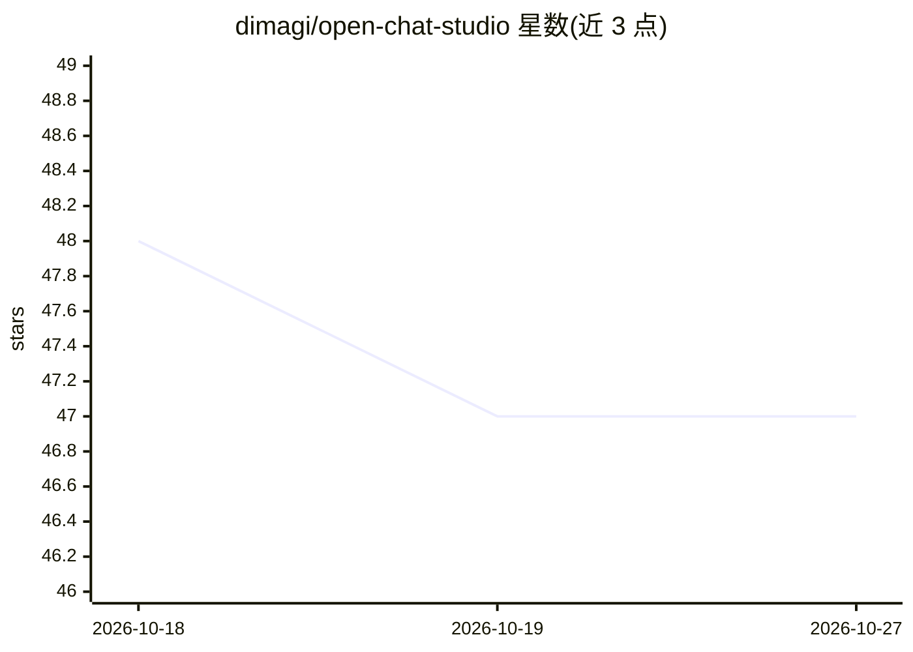

# dimagi/open-chat-studio

⭐ 47 · Python · BSD-3-Clause · 推送 2026-10-26 · [GitHub](https://github.com/dimagi/open-chat-studio) · [官网](https://docs.openchatstudio.com) · 组织维护

**构建、部署与评估 LLM 聊天应用的 Web 平台**

面向开发者的聊天机器人构建平台：支持接入 OpenAI、Anthropic、Groq、Gemini、Azure 等多种 LLM，提供聊天机器人创建、会话管理与消息平台集成工具，并支持对 AI 聊天应用进行评估。技术栈为 Python 3.13+/Django 后端、PostgreSQL(pgvector)、Redis、TypeScript 前端；开发环境需 Python、Node.js、Docker，LLM 交互依赖单独运行的 Celery 进程；可 Docker Compose 全栈运行或部署到 Heroku。

## 筛选速览

| 维度 | 判定 | 备注 |
|---|---|---|
| AI 角色 | `ai-ecosystem` | LLM/agent 周边工具 |
| 许可风险 | `permissive` | BSD-3-Clause |
| 部署形态 | `self-host` | docker 或自建部署 |
| 模型依赖 | — | README 未给出锁定关系 |
| 硬件要求 | — | 无带数字的原话,不猜 |
| 安装摩擦 | `low` | 无编译、无系统依赖或容器化 |
| 成熟度 | — | 结构信号不足 |

## 能力要点

- 支持 OpenAI/Anthropic/Groq/Gemini/Azure 等多家 LLM 接入
- 提供聊天机器人构建、会话管理与消息平台集成工具
- 支持 AI 聊天应用的部署与评估
- 提供 Docker 全栈开发环境与 Heroku 部署路径

## 适用场景

- 搭建并部署接入多种 LLM 的聊天机器人
- 管理和评估与用户的对话会话
- 将聊天应用集成到不同消息平台

## 场景标签

`聊天机器人` `模型评测` · 领域:对话与助手

## 证据(README 行号)

> L4: Open Chat Studio is a platform for building, deploying, and evaluating AI-powered chat applications. It provides too
> L15: - **LLM integrations:** OpenAI, Anthropic, Groq, Gemini, Azure, and more

## 星数曲线

2026-10-18 48 → 2026-10-27 47（-1）

---
*卡片 v1 · prompt 1.4 · 生成 2026-10-25 · 置信度 high · 依据 README sha `8f5fea93b34f` · [字段定义](../../DATASET.md)*
