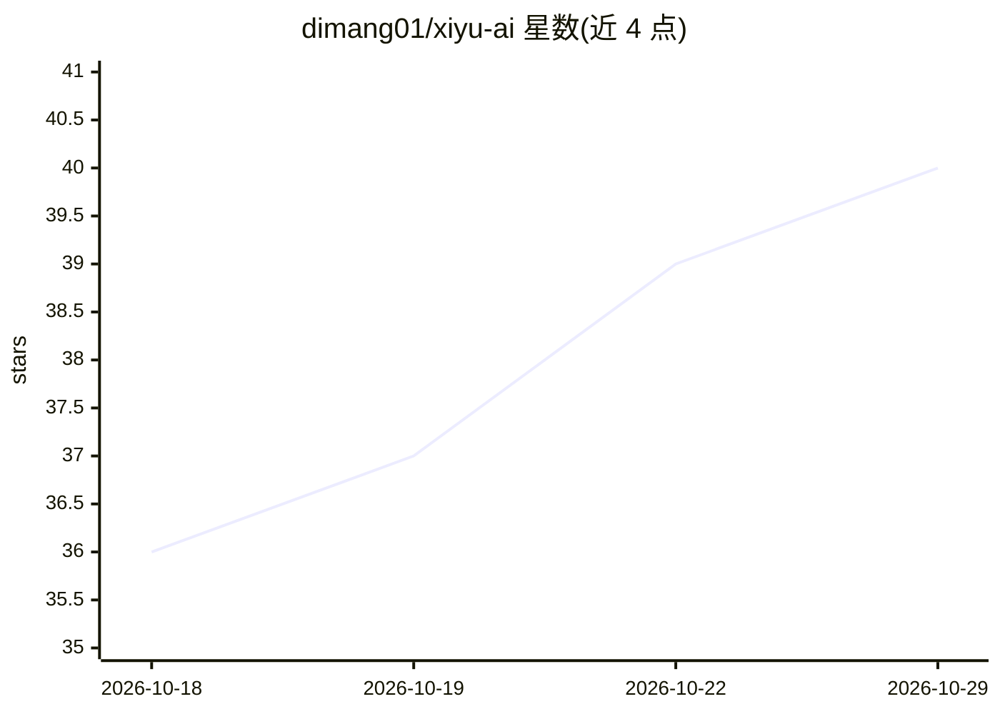

# dimang01/xiyu-ai

⭐ 40 · JavaScript · MIT · 推送 2026-06-14 · [GitHub](https://github.com/dimang01/xiyu-ai) · [官网](https://xiyuai.cc) · 个人维护 · 中文 README

**自托管的 AI 女友陪伴框架：微信聊天、记忆与主动消息**

开源的 AI 陪伴应用，将大模型组织为一个有固定人设、默认好感起点为暧昧的虚拟女生：46+ 条人生事件、5 阶段关系状态机、10 维情绪演化、7 层分层记忆与遗忘曲线、基于日程的主动消息、AI 生图（长相一致性）、ASR 情绪识别与 TTS。通过 iLink 协议接入微信收发消息，或用内置网页 Playground 聊天；Chat/Vision/ASR/TTS/Embedding/Search 七类能力各自独立选择 Provider（11 家 Chat 厂商 + OpenAI 兼容网关）。以 Docker 镜像或 npm 源码方式自托管，README 声明实验性、非 turnkey 产品。内置危机干预、未成年人保护（无关闭开关）与隐私过滤等安全机制。

## 筛选速览

| 维度 | 判定 | 备注 |
|---|---|---|
| AI 角色 | `ai-native` | 本体是模型或模型工具 |
| 许可风险 | `permissive` | MIT |
| 部署形态 | `self-host` | docker 或自建部署 |
| 模型依赖 | local-ok | 支持本地模型 |
| 硬件要求 | — | 无带数字的原话,不猜 |
| 安装摩擦 | `low` | 无编译、无系统依赖或容器化 |
| 成熟度 | `idea` | |

## 能力要点

- 5 阶段关系状态机 + 10 维情绪演化的陪伴人设引擎
- 7 层分层记忆 × 权重 × 遗忘曲线，每日反思引擎自动提炼
- 微信 iLink 接入：主动消息、连发整合、语音情绪识别、AI 规划发图
- 七类能力（Chat/Vision/ASR/TTS 等）独立切换 Provider，含 OpenAI 兼容网关

## 适用场景

- 自托管一个接入微信的长期陪伴型 AI 角色
- 研究带记忆、情绪状态机与主动消息的对话 agent
- 用浏览器 Playground 体验多模态陪伴对话而不接微信

## 场景标签

`聊天机器人` · 领域:对话与助手

## 证据(README 行号)

> L5: **默认对你有好感的 AI 女友 · 开源陪伴框架**
> L40: **核心定位**：不是聊天机器人，是把大模型组织成"一个心里已经悄悄喜欢你的女生"。

## 星数曲线

2026-10-18 36 → 2026-10-29 40（+4）

---
*卡片 v1 · prompt 1.4 · 生成 2026-10-25 · 置信度 high · 依据 README sha `b4b9a4979cab` · [字段定义](../../DATASET.md)*
