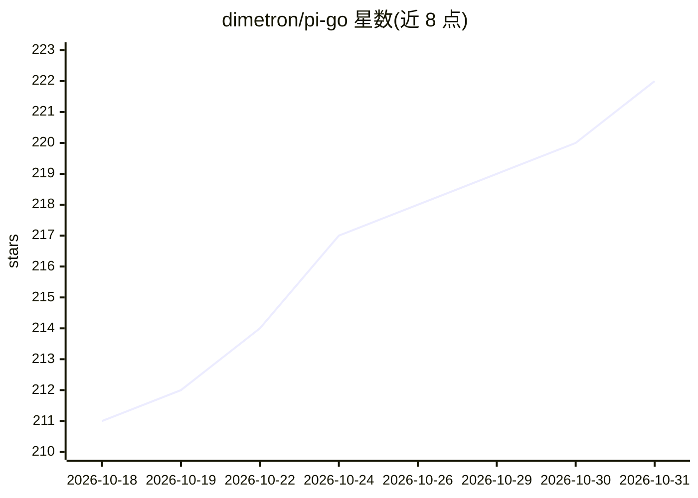

# dimetron/pi-go

⭐ 222 · Go · MIT · 推送 2026-10-30 · [GitHub](https://github.com/dimetron/pi-go) · [官网](https://pi-go.sh) · 个人维护

**面向开发者的终端 AI 编程 agent（Go 实现）**

基于 Google ADK Go 的终端编程 agent：以 Bubble Tea v2 TUI 交互，接入 Anthropic/OpenAI/Gemini/Mistral/xAI/Azure/OpenRouter/Ollama 等多家 LLM 提供商，运行受 os.Root 限制在项目目录内的沙箱工具（读写、shell、grep、git 等）。内置进程式子 agent 系统（explore/plan/reviewer 等 6 类）、Go/TS/Python/Rust/Java 的 LSP 集成、JSONL 会话持久化与分支、SQLite 存储的 4 层上下文记忆，支持 MCP、hooks、skills 及 Claude Code 兼容插件市场安装。要求 Go 1.27+ 与至少一个 LLM API key 或运行中的 Ollama 实例。

## 筛选速览

| 维度 | 判定 | 备注 |
|---|---|---|
| AI 角色 | `ai-native` | 本体是模型或模型工具 |
| 许可风险 | `permissive` | MIT |
| 部署形态 | `desktop` | 安装包/桌面程序 |
| 模型依赖 | local-ok | 支持本地模型 |
| 硬件要求 | — | 无带数字的原话,不猜 |
| 安装摩擦 | `low` | 无编译、无系统依赖或容器化 |
| 成熟度 | — | 结构信号不足 |

## 能力要点

- 多提供商 LLM 接入（Anthropic/OpenAI/Gemini/Mistral/xAI/Azure/OpenRouter/Ollama 等）
- os.Root 沙箱限制工具仅操作项目目录
- 进程式子 agent 系统（explore/plan/designer/reviewer/task/quick_task）
- Memory Palace：SQLite 存储的 4 层上下文记忆与 all-MiniLM-L6-v2 语义嵌入
- pi verify 基于 Sigstore 证明的发布校验，附带 SBOM

## 适用场景

- 在终端里让 AI 读取/编辑代码并执行命令完成编程任务
- 通过子 agent 与 Plan-Driven Development 流程拆解开发任务
- 在 IDE/编辑器中经 Unix socket JSON-RPC 集成使用
- 用 Ollama 本地模型离线运行编程 agent

## 场景标签

`编码 Agent` · 领域:编码与开发

## 证据(README 行号)

> L12: A terminal-based coding agent built on Google ADK Go. It connects to multiple LLM providers, runs
> L19: - **Multi-provider LLM** — Claude (Anthropic), GPT/O-series (OpenAI), Gemini (Google), Mistral, Grok (xAI), Azure O

## 星数曲线

2026-10-18 211 → 2026-10-31 222（+11）

---
*卡片 v1 · prompt 1.4 · 生成 2026-10-22 · 置信度 mid · 依据 README sha `37324bbc7474` · [字段定义](../../DATASET.md)*
