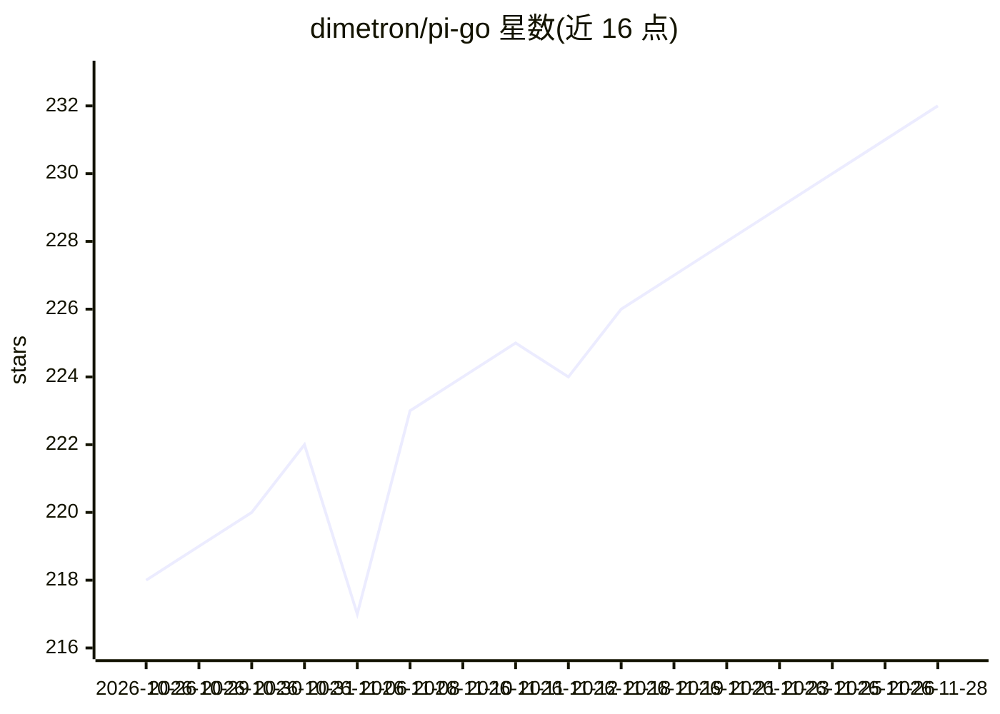

# dimetron/pi-go

⭐ 232 · Go · MIT · 推送 2026-11-23 · [GitHub](https://github.com/dimetron/pi-go) · [官网](https://pi-go.sh) · 个人维护

**终端里的 AI 编码代理：接入多模型为开发者执行代码任务**

基于 Google ADK Go 构建的终端编码代理，以 TUI/CLI 形式运行。提供沙箱化工具（读写、编辑、shell、grep、git）、LSP 集成（Go/TS/Python/Rust/Java）、进程级子代理系统、JSONL 会话持久化与分支压缩，以及 LLM 生成的 conventional commit。接入 Anthropic、OpenAI、Gemini、Mistral、xAI、Azure、OpenRouter、Ollama 等提供商，通过模型名前缀路由并经环境变量配置 API key；另提供 JSON 输出模式与 Unix socket JSON-RPC 服务端供 IDE 集成。

## 筛选速览

| 维度 | 判定 | 备注 |
|---|---|---|
| AI 角色 | `ai-native` | 本体是模型或模型工具 |
| 许可风险 | `permissive` | MIT |
| 部署形态 | `desktop` | 安装包/桌面程序 |
| 模型依赖 | local-ok | 支持本地模型 |
| 硬件要求 | — | 无带数字的原话,不猜 |
| 安装摩擦 | `low` | 无编译、无系统依赖或容器化 |
| 成熟度 | — | 结构信号不足 |

## 能力要点

- 多提供商模型接入，模型名前缀自动路由 API key 与 Base URL
- 沙箱工具经 os.Root 限制在项目目录内运行
- 进程式子代理系统（explore/plan/reviewer 等类型）与 LSP 集成
- release 提供 Sigstore 证明与 SBOM，可用 pi verify 校验二进制来源

## 适用场景

- 在终端里让 AI 代理读写代码、跑 shell 命令、生成提交
- 本地无网络依赖时通过 Ollama 守护进程运行模型
- 通过 JSON 模式或 RPC 服务端把代理接入编辑器/IDE
- 用 Plan-Driven Development 会话做规格驱动的开发流程

## 场景标签

`编码 Agent` · 领域:编码与开发

## 证据(README 行号)

> L12: A terminal-based coding agent built on Google ADK Go. It connects to multiple LLM providers, runs
> L19: - **Multi-provider LLM** — Claude (Anthropic), GPT/O-series (OpenAI), Gemini (Google), Mistral, Grok (xAI), Azure O
> L211: - At least one LLM provider API key or a running Ollama instance

## 星数曲线

2026-10-26 218 → 2026-11-28 232（+14）

---
*卡片 v1 · prompt 1.4 · 生成 2026-11-25 · 置信度 mid · 依据 README sha `389712aec086` · [字段定义](../../DATASET.md)*
