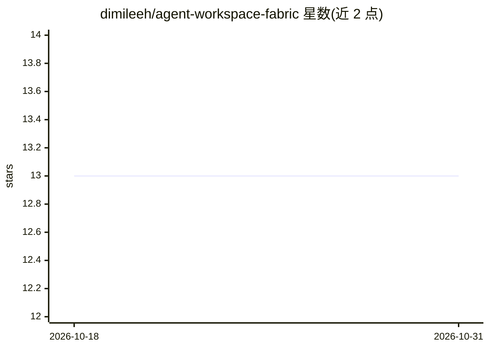

# dimileeh/agent-workspace-fabric

⭐ 13 · Python · Apache-2.0 · 推送 2026-10-30 · [GitHub](https://github.com/dimileeh/agent-workspace-fabric) · [官网](https://aira.pro/awf) · 个人维护

**编排 AI 编码 agent 的控制平面：隔离工作区+PR 全生命周期管理**

AI 编码 agent 的本地控制平面（alpha）：为 Codex、Claude Code、Cursor、Antigravity、OpenCode、Grok 等提供适配器，将每个任务置于隔离 git worktree 与专属 Docker Compose 栈中，执行 profile 驱动的 setup 与验证后创建 PR，并由 PR monitor 循环处理评审评论、CI 修复、基线同步，过门禁后可选自动合并。提供 FastAPI REST API、Typer CLI、MCP 工具与本地操作台。当前为本地单机 Core，多节点、云端与多租户为未来层。

## 筛选速览

| 维度 | 判定 | 备注 |
|---|---|---|
| AI 角色 | `ai-ecosystem` | LLM/agent 周边工具 |
| 许可风险 | `permissive` | Apache-2.0 |
| 部署形态 | `self-host` | docker 或自建部署 |
| 模型依赖 | — | README 未给出锁定关系 |
| 硬件要求 | — | 无带数字的原话,不猜 |
| 安装摩擦 | `low` | 无编译、无系统依赖或容器化 |
| 成熟度 | `idea` | |

## 能力要点

- 每任务隔离 git worktree + 独立 Docker Compose 栈
- 6 种编码 agent 适配器（Codex/Claude Code/Cursor/Antigravity/OpenCode/Grok）
- PR monitor 循环：评论处理、CI 修复、基线同步、门禁后自动合并（默认关闭）
- REST/CLI/MCP 三种客户端接口与本地操作台

## 适用场景

- 并行运行多个 AI 编码 agent 互不冲突地开发同一仓库
- 自动看管 agent 创建的 PR 直到合并
- 让 planner 或人工操作员通过 MCP 驱动 agent 执行任务

## 场景标签

`编码 Agent` `代码审查` `多智能体` · 领域:Agent 开发

## 证据(README 行号)

> L21: It gives Codex, Claude Code, Antigravity, and future coding agents a repeatable way
> L98: - Codex, Claude Code, Cursor, Antigravity, OpenCode, and Grok adapters.
> L65: 6. Optionally run AWF-owned Plan -> Execute -> Compare iterations.

## 星数曲线

2026-10-18 13 → 2026-10-31 13（+0）

---
*卡片 v1 · prompt 1.4 · 生成 2026-10-31 · 置信度 mid · 依据 README sha `4bfed4e2bf83` · [字段定义](../../DATASET.md)*
