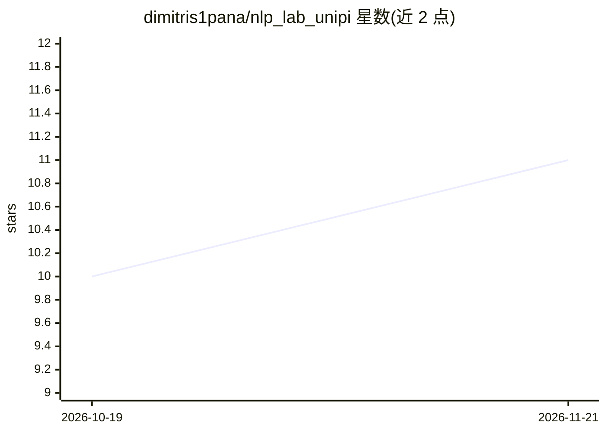

# dimitris1pana/nlp_lab_unipi

⭐ 11 · Jupyter Notebook · 推送 2026-05-22 · [GitHub](https://github.com/dimitris1pana/nlp_lab_unipi) · 组织维护

**皮雷埃夫斯大学 NLP 课程的教学代码仓库**

希腊皮雷埃夫斯大学信息学系春季学期《自然语言处理导论》课程的官方 GitHub 仓库，内容覆盖从乔姆斯基文法与句法分析等经典形式化方法到 BERT、T5、GPT 等模型，理论讲解与 Python 实现并用。技术栈为 Python 3.10、Jupyter Notebook、NLTK、stanza、Scikit-Learn、PyTorch，用 Poetry 管理依赖。安装方式为 git clone 仓库；README 另附教材、论文与数学基础补充资源清单。

## 筛选速览

| 维度 | 判定 | 备注 |
|---|---|---|
| AI 角色 | `ai-knowledge` | 知识聚合/清单类 |
| 许可风险 | `none` | — |
| 部署形态 | `None` |  |
| 模型依赖 | — | README 未给出锁定关系 |
| 硬件要求 | — | 无带数字的原话,不猜 |
| 安装摩擦 | `low` | 无编译、无系统依赖或容器化 |
| 成熟度 | — | 结构信号不足 |

## 能力要点

- 覆盖经典文法解析到 BERT/T5/GPT 的课程内容
- Python 3.10 + Jupyter Notebook 交互式实现
- NLTK/stanza/PyTorch/Hugging Face 工具链
- 附教材、研究论文与数学基础资源清单

## 适用场景

- 修读该课程时获取配套代码与讲义
- 自学从语言学基础到深度学习 NLP 的路径
- 查找 Attention/BERT 等论文的配套实现入口

## 场景标签

`教程课程` · 领域:学习与行业

## 证据(README 行号)

> L3:  Official GitHub repository for the **Introduction to Natural Language Processing** course taught during the Spring 
> L7: This course covers a broad spectrum of NLP, starting from classical formalisms (e.g., Chomsky grammars and parsing) 

## 星数曲线

2026-10-19 10 → 2026-11-21 11（+1）

---
*卡片 v1 · prompt 1.4 · 生成 2026-11-19 · 置信度 high · 依据 README sha `043f987d84af` · [字段定义](../../DATASET.md)*
