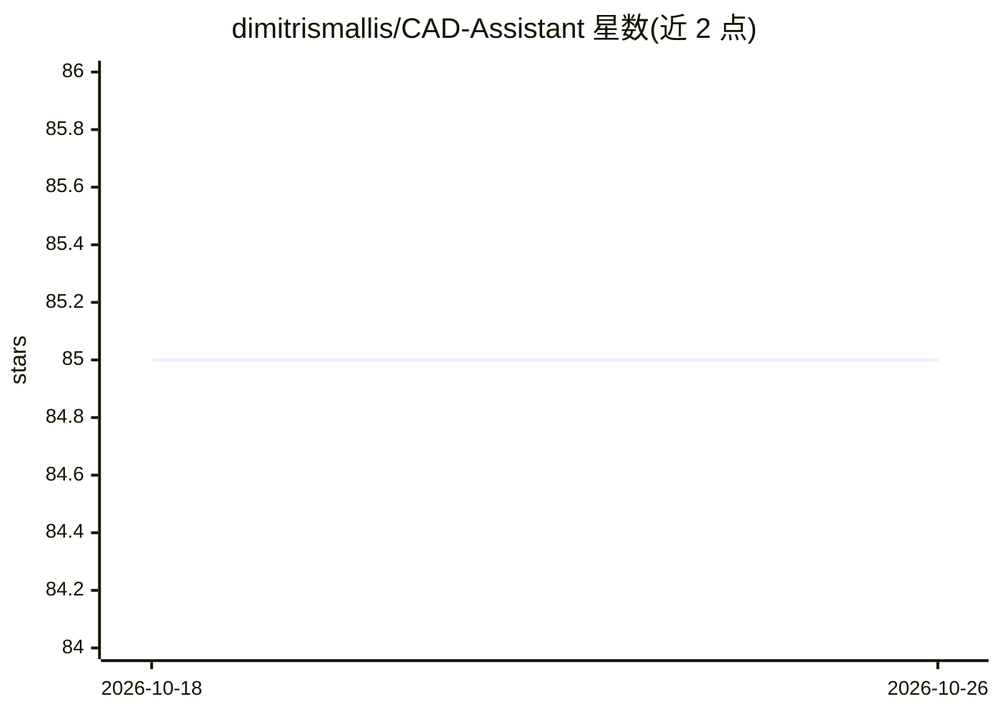

# dimitrismallis/CAD-Assistant

⭐ — · [GitHub]() · 组织维护

**ICCV 2025 论文代码：工具增强视觉语言模型生成 FreeCAD 代码解 CAD 任务**

CAD-Assistant 的官方代码库，是面向 AI 辅助 CAD 的工具增强视觉语言模型框架：接收文本、草图、绘制命令与 3D 扫描等多模态输入，生成在 CAD 软件中直接执行的 FreeCAD 代码。当前发布包含与 FreeCAD 集成的框架实现、2D 草图渲染工具 sketch_recognizer（改编自 Vitruvion）与 3D 实体识别工具 solid_recognizer（基于 Python OCC），支持通过目录与 config.json 注册新工具。提供 Docker 镜像（内置 FreeCAD 与 Python OCC），需配置 OpenAI API key，在 SGP-Bench 的 2D/3D 划分上评测（含 1700 个预加载 FCStd 测试文件）。许可为 Attribution-NonCommercial。

## 筛选速览

| 维度 | 判定 | 备注 |
|---|---|---|
| AI 角色 | `ai-native` | 本体是模型或模型工具 |
| 许可风险 | `none` | — |
| 部署形态 | `self-host` | docker 或自建部署 |
| 模型依赖 | — | README 未给出锁定关系 |
| 硬件要求 | — | 无带数字的原话,不猜 |
| 安装摩擦 | `low` | 无编译、无系统依赖或容器化 |
| 成熟度 | — | 结构信号不足 |

## 能力要点

- 多模态输入（文本/草图/绘制命令/3D 扫描）生成可执行的 FreeCAD 代码
- 内置 2D 草图渲染与 3D 实体识别工具，支持注册自定义工具
- Docker 镜像内置 FreeCAD 与 Python OCC 全部依赖
- 附带 SGP-Bench 1700 个 FCStd 预处理测试样本与评测脚本

## 适用场景

- 研究者复现 ICCV 2025 论文的 CAD 问答评测
- 通过对话/草图驱动生成 CAD 模型代码
- 在其框架上扩展新的 CAD 工具与 FreeCAD 命令

## 场景标签

`多模态` `代码生成` `模型评测` · 领域:编码与开发

## 证据(README 行号)

> L18: CAD-Assistant is a tool-augmented VLLM framework for AI-assisted CAD. Our framework generates FreeCAD code that is 
> L22: This release includes the CAD-Assistant framework implementation intergrated with FreeCAD and augmented with a 2D C

## 星数曲线

2026-10-18 85 → 2026-10-26 85（+0）

---
*卡片 v1 · prompt 1.4 · 生成 2026-10-24 · 置信度 high · 依据 README sha `88ef49a6e9f8` · [字段定义](../../DATASET.md)*
