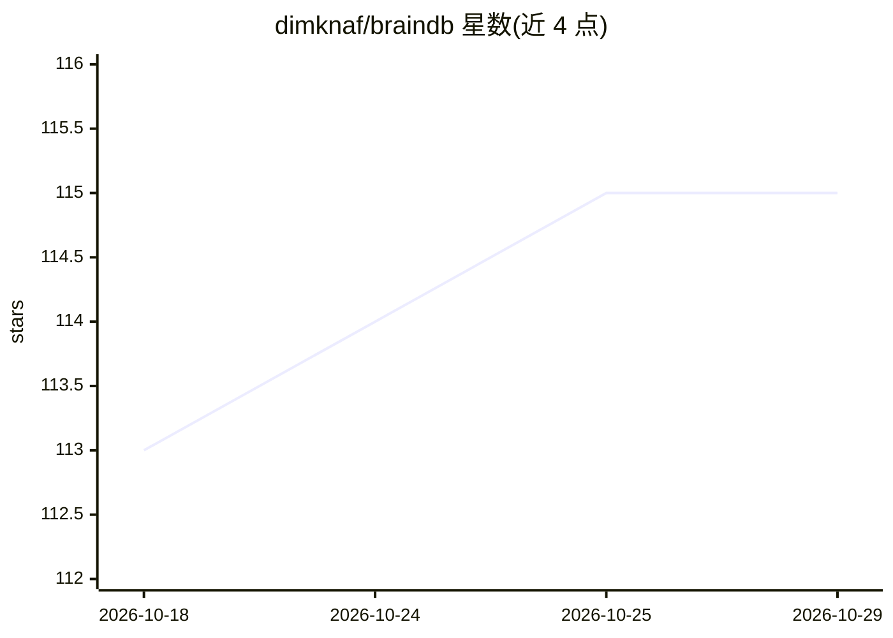

# dimknaf/braindb

⭐ 115 · Python · Apache-2.0 · 推送 2026-10-12 · [GitHub](https://github.com/dimknaf/braindb) · 个人维护

**面向 LLM agent 的持久记忆数据库与 REST API**

受 Karpathy LLM wiki 概念启发的记忆数据库：在 PostgreSQL + pg_trgm + pgvector 上存储 thoughts/facts/sources/datasources/rules 五类带类型实体，支持 supports/contradicts 等图关系、3 跳图遍历、时间衰减与 always-on 规则注入，通过 HTTP API 供外部 LLM 工具调用。内置自然语言 agent（OpenAI Agents SDK，可插拔 OpenAI 兼容后端，默认推荐 DeepInfra，支持 vLLM/Ollama 等）。以 Docker Compose 服务栈形式部署，含 watcher 自动摄取文件、wiki 调度器与只读前端，数据库可捆绑或自带 Postgres。

## 筛选速览

| 维度 | 判定 | 备注 |
|---|---|---|
| AI 角色 | `ai-ecosystem` | LLM/agent 周边工具 |
| 许可风险 | `permissive` | Apache-2.0 |
| 部署形态 | `self-host` | docker 或自建部署 |
| 模型依赖 | local-ok | 支持本地模型 |
| 硬件要求 | — | 无带数字的原话,不猜 |
| 安装摩擦 | `low` | 无编译、无系统依赖或容器化 |
| 成熟度 | — | 结构信号不足 |

## 能力要点

- 五类类型化实体与 supports/contradicts/derived_from 等图关系
- fuzzy + 语义双路检索、几何平均合并、3 跳图遍历与时间衰减
- always-on 行为规则注入每次上下文调用
- 内置自然语言 agent 单端点，可插拔 OpenAI 兼容后端

## 适用场景

- 为 LLM agent 提供可读写的持久外部记忆
- 让外部调用方用自然语言直接查询和写入记忆库
- 自动摄取 markdown 文档并溯源关联事实

## 场景标签

`Agent 记忆` `知识图谱` · 领域:Agent 开发

## 证据(README 行号)

> L7: A memory database and REST API for LLM agents. Store and retrieve thoughts, facts, sources, documents, and behaviora
> L9: It also ships with **its own internal agent** (OpenAI Agents SDK with pluggable OpenAI-compatible providers — **Deep
> L16: - **vs. classic graph DBs** (Neo4j, Memgraph). Those are general-purpose graph stores with their own query language

## 星数曲线

2026-10-18 113 → 2026-10-29 115（+2）

---
*卡片 v1 · prompt 1.4 · 生成 2026-10-23 · 置信度 high · 依据 README sha `894e12debfb1` · [字段定义](../../DATASET.md)*
